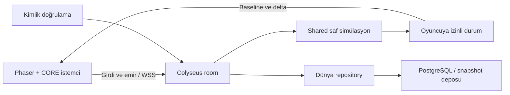

# 24 oyunculu otomasyon, RTS ve aksiyon oyunları için backend araştırması

Araştırma tarihi: **12 Ekim 2026**. Repo tabanı: `b802f488`.
Hedef: Mindustry benzeri co-op/PvP otomasyon, bullet hell/mini MOBA ve
oturum veya dünya başına **en çok 24 oyunculu** açık dünya RTS.
Toplam eşzamanlı oyuncu sayısı, dünya büyüklüğü ve barındırma bütçesi henüz belirlenmedi.

## Karar önerisi

**İlk tercih: Colyseus 0.18 üzerinde sunucu otoriteli TypeScript simülasyonu;
kalıcı dünya verisi için sunucuya ait PostgreSQL ve gerektiğinde snapshot dosya depolaması.**
İlk dikey dilimde tek sunucu süreci ve tek dünya yeterlidir. Çok sayıda dünya
çalıştırma ihtiyacı ölçülünce süreç sayısı ve eşleştirme altyapısı büyütülür.
Bu bir üretim kapasitesi kabulü değildir; repo uyumu yerel deneyle doğrulanan
bir seçim önerisidir.

**Talo'yu ana oynanış sunucusu olarak seçmiyorum.** Gerçek WebSocket/kanal
özellikleri vardır; fakat araştırılan hazır sözleşme oyun kuralları, tick,
otoriter savaş/üretim ve istemci düzeltmesi sağlayan bir runtime değildir.
Talo hesap, Steam entegrasyonu, kayıt ve canlı işletim ihtiyaçları için
ayrıca değerlendirilebilir. [Socket istekleri](https://docs.trytalo.com/1.x/sockets/requests),
[kanal mesajı kaynak kodu](https://raw.githubusercontent.com/TaloDev/backend/develop/src/socket/listeners/gameChannelListeners.ts).

Bu hedefte 24 oyuncu bir dünya için sınırlı bir bağlantı sayısıdır; asıl yük
fabrika makineleri, taşıma ağları, yapay zekâ, birimler, mermiler ve görünür
durum güncellemelerinden gelir. Backend seçimi bu algoritmaların maliyetini
kendiliğinden çözmez. Özellikle dev bir fabrikayı her tick bütün oyunculara
gönderen bir tasarım, oyuncu sayısı düşükken de pahalı olabilir.

## Yöntem ve gerçek kanıt

Resmî dokümanlar, güncel npm metadata'sı ve resmî kaynak depoları karşılaştırıldı.
Graphify `query`/`affected` ile bulunan ilişkiler kaynakla doğrulandı.
Pencil kaynağına erişilmedi. Üretim kodu, dependency manifesti ve repo kilidi
değiştirilmedi; deney vitrinin git dışı records alanında ayrı bir
backend-research dizininde kuruldu. Rapordaki mimari seçimler **öneri**, doküman özellikleri
**kaynak bilgisi**, yerel sonuçlar **ölçülen kanıt** olarak okunmalıdır.

### Çalıştırılan deneyler

| Deney                                         | Sonuç                                                                                                            | Kanıtın sınırı                                                                                         |
| --------------------------------------------- | ---------------------------------------------------------------------------------------------------------------- | ------------------------------------------------------------------------------------------------------ |
| Mevcut `headless.test.ts`                     | 2/2 PASS; gerçek Node çocuğu ile test sürecinin beş seedli senaryosu eşleşir                                     | Chromium/WebKit/Android arasında bit eşitliği testi değildir                                           |
| Güncel Colyseus + gerçek VOL.TEST simülasyonu | Node 22.23.1; 24 gerçek WebSocket istemcisi, 24 gerçek araç; 24 girdi ACK; hareketin schema ile eşitlenmesi PASS | Tek makine, loopback, kısa bağlantı/entegrasyon deneyi                                                 |
| Olumsuz kontrol                               | Aralık dışı hareket girdisi reddedildi; 25. istemci aynı odaya alınmadı                                          | Girdi doğrulayıcısı deneyde bizim yazdığımız koddur; framework bütün oyun kurallarını hazır doğrulamaz |

İlk deneme manifestinde diğer paketle aynı sanılan `ws-transport` sürümü
yayımlanmamıştı; npm ETARGET verdi. Paketler ayrı sorgulanıp aşağıdaki
gerçek sürümlerle kuruldu; son deney çıkış kodu 0'dır. Paket sürümlerinin
son eklerinin eşit olması gerekmiyor.

| Deneyde kurulan paket    | Sürüm   | Runtime                                                          |
| ------------------------ | ------- | ---------------------------------------------------------------- |
| `@colyseus/core`         | 0.18.18 | Node ≥22                                                         |
| `@colyseus/sdk`          | 0.18.5  | Paket engine kaydı Node ≥12; gerçek hedef webview ayrıca sınanır |
| `@colyseus/schema`       | 5.0.39  | Schema 5 ailesi                                                  |
| `@colyseus/ws-transport` | 0.18.4  | Node ≥22                                                         |

Yeniden koşma (git dışı deney kaynakları ve kurulu bağımlılıklar mevcutsa):

```sh
pnpm --filter @volstudio/vol-test exec vitest run tests/sim/scenarios/headless.test.ts
pnpm exec tsx --tsconfig games/vol-test/tsconfig.json devtools/vol-showcase/records/backend-research/probe.ts
```

Deney `tsx` ile çalıştı; yeni backend'in tam TypeScript build kabulü değildir.
Prediction, yeniden bağlanma, kalıcı kayıttan toparlanma, yetkili Steam girişi,
TLS/CSP, ağ bozunumu ve fiziksel webview deneyde **NOT-RUN**.
Büyük otomasyon dünyası ve yoğun bullet hell için gecikme/CPU/bant genişliği
ölçülmedi. Bu sonuçtan “24 oyunculu ürün hazır” çıkarılamaz.

## Repo ile uyum ve eksikler

| Alan                  | Bugünkü kaynak kanıtı                                                                                                                   | Backend açısından sonuç                                                                                                                      |
| --------------------- | --------------------------------------------------------------------------------------------------------------------------------------- | -------------------------------------------------------------------------------------------------------------------------------------------- |
| Başsız simülasyon     | [Simulation.ts](../games/vol-test/src/sim/Simulation.ts), [headless testi](../games/vol-test/tests/sim/scenarios/headless.test.ts)      | Simülasyon Phaser bilmez; aynı TypeScript mekanizmaları Node sunucusunda çalışabiliyor                                                       |
| Çoklu araç ve komut   | [command.ts](../games/vol-test/src/sim/command.ts), Simulation `CommandSource`, kimlikli `Vehicle`                                      | Oyuncu niyetini simülasyona aktarmak için başlangıç var; ağ oyuncusu → yetkili entity eşlemesi eklenmeli                                     |
| Simülasyon saati      | [SimulationClock.ts](../core/src/time/SimulationClock.ts), [WorldScene.ts](../games/vol-test/src/scenes/WorldScene.ts)                  | CORE varsayılanı kısmi adım üretebilir; gerçek oyun `partialStep: 'defer'` kullanıyor. Ağ simülasyonu sabit adımı korumalı                   |
| Rastgelelik           | [random.ts](../core/src/random/random.ts)                                                                                               | Durum aktarılabilir RNG var; bütün dünyayı ve her bağımsız RNG akışını eksiksiz kaydetmek ayrıca gerekir                                     |
| Sunucuya uygun import | [CORE exports](../core/package.json), [Phaser sınırı](../core/docs/phaser-boundary.md)                                                  | `math`, `physics`, `time`, `random`, `spatial` alt yolları kullanılmalı; DOM/sunum taşıyan kök barrel sunucu başlangıcı olmamalı             |
| Kalıcılık             | [scopedStores.ts](../tauri-v2/src/adapters/scopedStores.ts), [scopedStorage.ts](../core/src/persistence/scopedStorage.ts)               | `synced` bugün native dosya + Steam Auto-Cloud düzenidir; browser fallback localStorage'dır. Multiplayer dünya/veritabanı otoritesi değildir |
| Büyük dünya kaydı     | [native tasarım](../tauri-v2/DESIGN.md)                                                                                                 | Native store ve Steam Cloud komutları 1 MiB sınırına sahip. Büyük dünyayı buraya sığdırmak için güvenlik sınırı kaldırılmaz                  |
| Ağ istemcisi          | CORE/oyun/kabuk runtime ve lock taraması                                                                                                | Colyseus/Talo/Nakama/SpacetimeDB istemcisi veya ortak multiplayer protokolü mevcut değil                                                     |
| Uzak bağlantı         | [ürün CSP](../games/vol-test/src-tauri/tauri.conf.json) `connect-src`                                                                   | Şu an yalnız self/IPC; ürünün gerçek HTTPS/WSS uçları açık listeyle eklenmeli. Tarayıcı probu paketli Tauri kabulü yerine geçmez             |
| Steam kimliği/taşıma  | [steamworks.ts](../tauri-v2/src/platform/steamworks.ts), [service.rs](../tauri-v2/plugins/vol-steamworks/src/service.rs)                | Input/Cloud yüzeyi var; giriş ticket'ı, lobby ve SteamNetworkingSockets yüzeyi yok                                                           |
| Dünya geri yükleme    | Simülasyon/world/combat kaynak taraması                                                                                                 | Tam dünya snapshot codec'i, restore, ağ baseline ve rollback sözleşmesi yok; yalnız son poz digest'i bunların yerine geçmez                  |
| Workspace sahipliği   | [pnpm-workspace.yaml](../pnpm-workspace.yaml), [layers.mjs](../scripts/quality/layers.mjs), [tsconfig](../games/vol-test/tsconfig.json) | Backend paketi eklemek bugün sıfır yapılandırma değildir; sunucu/shared kaynakları ve gate kapsamı bilinçli tanımlanmalı                     |

Nakama tarafında önemli bir uyum farkı vardır: repo ES2022, ESM, `Map` ve
modern standart kütüphane kullanır. Nakama'nın resmî TypeScript runtime
sözleşmesi Goja/ES5, Node/browser API yokluğu ve sandbox sınırlarını taşır.
Sadece TypeScript kullanıyor olması mevcut simülasyonun doğrudan taşınacağını
kanıtlamaz; ayrı bundle/polyfill ve runtime kabulü veya harici Node simülasyonu
gerekir. [Nakama TypeScript runtime](https://heroiclabs.com/docs/nakama/server-framework/typescript-runtime/).

## Aday karşılaştırması

Tablo bu repo ve 24 kişilik oyun hedefi için mühendislik değerlendirmesidir;
ölçülmemiş performansa sayısal puan verilmedi.

| Aday                       | Oynanış otoritesi                                                                         | Hazır hesap/meta hizmetleri                                            | Repo ile sürtünme                                                               | Bu hedefte karar                                            |
| -------------------------- | ----------------------------------------------------------------------------------------- | ---------------------------------------------------------------------- | ------------------------------------------------------------------------------- | ----------------------------------------------------------- |
| Colyseus 0.18              | Kendi Node/TS kurallarını room içinde koşturur; durum eşitlemesi ve yeni netcode araçları | İsteğe bağlı auth/database/admin; kapsam ve olgunluk ayrıca doğrulanır | En düşük: Node 22 + TS + başsız simülasyon                                      | **Birinci tercih**                                          |
| Talo 1.6.2                 | Socket/kanal iletişimi var; hazır oyun tick/otorite runtime'ı kanıtlanmadı                | Steam, hesap, saves, stats, leaderboard, config/analytics              | Özel TS istemci adapter'ı; self-host backend ayrı Node 24 ve veri servisleri    | Meta servis adayı; tek başına PvP simülasyon seçimi değil   |
| Nakama                     | Authoritative match handler veya harici headless sunucu                                   | Hesap, sosyal, storage, matchmaking ve leaderboard kapsamı güçlü       | Sandbox ile mevcut modern TS simülasyonu arasında fark; veya iki sunucu katmanı | Sosyal/ranked hizmetler erken zorunluysa ikinci tercih      |
| SpacetimeDB 2.0            | Reducer/tablo değişimi + gerçek zamanlı subscription                                      | Kimlik ve kalıcı veri temelinden özel sistemler kurulabilir            | Simülasyonu mutable nesnelerden tablo/transaction modeline taşıma               | Kalıcı dünya önceliği çok güçlenirse deney adayı            |
| Özel Node + `ws`/Socket.IO | Tam kontrol; bütün oyun protokolünü bizim yazmamız gerekir                                | Biz kurarız                                                            | TS reuse kolay; sync/prediction/reconnect/güvenlik bakımı yüksek                | Colyseus'un ölçülen darboğazı veya protokol gereği çıkarsa  |
| SteamNetworkingSockets/SDR | Native taşıma; oyun otoritesi ve simülasyonu yine bize ait                                | Steam platform hizmetleri; genel cross-platform backend değildir       | Yeni Rust/JS IPC, ticket ve taşıma adaptörü                                     | Steam ağırlıklı oyuncu-hosted co-op için koşullu alternatif |

Nakama gerçekten authoritative multiplayer sağlar; bunu Talo ile aynı
kategoriye indirgemek yanlış olur. Oyuncuların hangi maça gireceği ve harici
headless sunucu filosunun yönetimi de belgelenmiştir. İki katmanlı
Nakama + Node simülasyonu teknik olarak makuldür; ilk ürün için ek dağıtım
ve kimlik maliyeti vardır. [Authoritative multiplayer](https://heroiclabs.com/docs/nakama/concepts/multiplayer/authoritative/),
[harici sunucu koordinasyonu](https://heroiclabs.com/docs/nakama/concepts/multiplayer/session-based/).

SpacetimeDB'nin güncel sürümünde **TypeScript sunucu modülü vardır**;
“yalnız Rust/C#” değerlendirmesi bayattır. Reducer değişiklikleri transaction
olarak uygulanır, istemci sorgulara abone olur; memory + commit-log modeli
kalıcı dünya için ilgi çekicidir. Ancak bizim simülasyon nesneleri, pool,
timer ve snapshot sahipliği yeniden modellenir. Her mermi hareketinin
tablo/abonelik maliyeti gerçek yükte sınanmalıdır. Lisansı MIT değildir:
BSL 1.1 kaynak erişimi ve sonradan AGPL/linking exception sözleşmesi ayrı
değerlendirilmelidir. [Dil desteği](https://spacetimedb.com/docs/intro/language-support/),
[reducers](https://spacetimedb.com/docs/functions/reducers/),
[transaction](https://spacetimedb.com/docs/databases/transactions-atomicity/),
[mimari/lisans FAQ](https://spacetimedb.com/docs/intro/faq/).

Socket.IO mesaj sırasını korur, fakat varsayılan teslim garantisi at-most-once'dır;
kopma sırasında kayıp için retry/kalıcılık/offset bizim sorumluluğumuzdur.
Taşıma seçimi tek başına oyun protokolü sağlamaz. [Teslim garantileri](https://socket.io/docs/v4/delivery-guarantees/).
SDR de Colyseus WebSocket sunucusunun otomatik önüne bağlanan bir proxy değildir;
Steam'in kendi bağlantı ve ticket API'lerinin uygulanmasını gerektirir.
[Steam Datagram Relay](https://partner.steamgames.com/doc/features/multiplayer/steamdatagramrelay?l=english).

## Colyseus tercihinin güçlü tarafı ve gerçek sınırları

0.18 ile `defineInput`, `setFixedTimestep`, client prediction/reconciliation,
remote interpolation, predicted spawn/event ve lag compensation araçları
eklenmiştir. “Colyseus yalnız state sync yapar, prediction'ın tamamı sıfırdan
yazılır” bilgisi güncel değildir. Buna rağmen repo fiziğini bu sözleşmeye
bağlamak, gerekli state'i kaydetmek ve yeniden oynatılan ses/efekti tek
sefer üretmek ürün işidir. [0.18 geçişi](https://docs.colyseus.io/migrating/0.18),
[prediction](https://docs.colyseus.io/netcode/client-prediction),
[determinism sözleşmesi](https://docs.colyseus.io/netcode/determinism).

Mevcut SimulationClock ve Colyseus saatini aynı simülasyonun iki bağımsız
otoritesi yapmamak gerekir. Sunucuda tek adım sürücüsü, shared saf `step`
ve render tarafında ayrı interpolation kullanılır. Input ve prediction
adım oranı framework sözleşmesiyle eşleşir; ağ state patch oranı ayrı
ayarlanabilir. Deneyde fizik 60 Hz, patch 20 Hz idi; bu oranlar ürün
bütçesi olarak kabul edilmedi. [Sunucu input/fixed timestep](https://docs.colyseus.io/netcode/server-input).

Her room tek sürece aittir. Çok süreç daha fazla **dünya/oda** barındırır;
tek ağır dünyanın simülasyonunu kendiliğinden işlemciler arasında bölmez.
Çok süreçli eşleştirme/presence için resmî Redis yolu vardır.
“24 kişi/dünya” ile “bütün üründe toplam 24 kişi” farklı kapasite sorularıdır.
[Ölçekleme](https://docs.colyseus.io/scalability).

StateView fog-of-war/takım/görüş alanı için kullanılabilir; fakat resmî
belge büyük veri kümeleri için optimizasyon sınırını açıkça söylüyor.
Sadece renderer'da düşmanı gizlemek PvP gizliliği sağlamaz: görünmemesi
gereken state sunucudan gönderilmemelidir. Streaming collection eklemeleri
tick'lere dağıtabilir; güncel API deneysel, sonraki field güncellemeleri
bu bütçeyle sınırlanmaz. Çok büyük fabrika için chunk/baseline/delta
stratejisi ayrıca ölçülmelidir. [StateView](https://docs.colyseus.io/state/view),
[streaming sınırları](https://docs.colyseus.io/state/streaming).

İlk platform tabanı standart **HTTPS/WSS** olmalıdır. WebSocket TCP'dir;
kayıp pakette sıralı teslim gecikmesi aksiyonda hissedilebilir.
Colyseus WebTransport/QUIC ve unreliable kanalı vardır ama resmî uygulama
deneyseldir. WebSocket'te `.unreliable()` state alanları ilk full sync
sonrasında güncellenmez; unreliable input reliable kanala düşer.
WebView2, WebKitGTK ve Android WebView ölçülmeden bu özelliğe bağlanılmaz.
[WebSocket](https://docs.colyseus.io/server/transport/ws),
[WebTransport uyarıları](https://docs.colyseus.io/server/transport/webtransport).

Reconnect oyuncuyu mevcut canlı oturuma geri alabilir. Süreç çökmesi,
world restore ve başka sürece taşıma ayrı sorunlardır; geliştirici reload
kipi production crash recovery sayılmaz. Oda boşalınca dispose olabilecek
oturum ile oyuncusuz da çalışan kalıcı dünya farklı yaşam döngüsüdür.
[Rooms](https://docs.colyseus.io/room),
[reconnection](https://docs.colyseus.io/room/reconnection).

0.18'in yeni `@colyseus/database` katmanı auth, saves, leaderboard ve
operasyon hizmetleri sunuyor; SQLite/PostgreSQL seçenekleri ve kendi
veritabanını kullanma yolu var. Bu nedenle “meta özellik için mutlaka
ikinci backend” şartı yoktur. Katman yeni, Drizzle 1.0 RC tabanlıdır;
deneyde kurulmadı. Dünya snapshot/journal işini kullanıcı cloud save API'sine
eşitlemeden kendi domain repository'siyle tanımlamak daha güvenlidir.
[Database](https://docs.colyseus.io/database).

## Talo ne zaman tercih edilir?

Hesap, leaderboard, stats, JSON player save ve canlı config/analitik hazır
olmalı; oynanış yerel veya ayrı güvenilir hostta çalışmalıysa Talo güçlü
adaydır. Özel channels ile party/lobby ve düşük sıklıklı multiplayer
etkileşimleri kurulabilir. Talo'yu yalnız analytics servisi diye küçültmek de,
kanal broadcast'ını PvP simülasyon otoritesi saymak da doğru değildir.
[Genel kapsam](https://docs.trytalo.com/1.x),
[kanallar](https://docs.trytalo.com/1.x/http/game-channel-api),
[oyuncu save sözleşmesi](https://docs.trytalo.com/1.x/http/game-save-api).

Steam ticket doğrulama ve Steam verileriyle eşleşme belgelenmiştir.
Repo'nun native katmanına `GetAuthTicketForWebApi` ömrü/cancel akışı yine
eklenmelidir; istemciden gelen SteamID tek başına güvenilir kimlik değildir.
Publisher key güvenilir sunucuda kalır. [Talo Steamworks](https://docs.trytalo.com/1.x/integrations/steamworks/),
[Steam ticket doğrulaması](https://partner.steamgames.com/doc/webapi/isteamuserauth?l=english).

Talo request verification replay/tampering kontrolleri sunar. İstemcinin
kendi yazdığı skor veya kaynak miktarını imzalaması onun oynanış açısından
doğru olduğunu kanıtlamaz; bu mimari çıkarımdır. Ranked sonuç ve ortak
envanterin yazıcısı güvenilir oyun sunucusu olmalıdır. Admin yetkisi ile
gameplay key/session kapsamları ayrı ele alınır. [Request verification](https://docs.trytalo.com/1.x/http/request-verification),
[Admin auth](https://docs.trytalo.com/1.x/admin/authentication).

Güncel resmî seçenekler Godot, Unity ve custom HTTP/standart socket'tir;
hazır Phaser/TypeScript istemci SDK'sı doğrulanmadı. Talo backend'in
TypeScript olması bunu sağlamaz. Bizim adapter session/socket ticket
yenileme, hata, iptal/reconnect ve kimlik bağlarını sahiplenir.

Resmî self-host compose **MySQL + Redis + ClickHouse** ve reverse proxy
taşır; önerilen Colyseus/PostgreSQL tasarımına ikinci backend olarak
eklendiğinde ayrı SQL/analytics işletimi getirir. Talo 1.6.2 manifesti
Node ≥24 ister. Repo'nun deterministik üretim Node 22 pini bunun için
değiştirilmez; ayrı servis runtime'ı kullanılır.
[Resmî compose](https://raw.githubusercontent.com/TaloDev/hosting/main/examples/caddy/docker-compose.yml),
[manifest](https://raw.githubusercontent.com/TaloDev/backend/develop/package.json).
9 Ekim 2026 tarihli 1.6.2 release taze doğrulandı; genel release listesi
cache'inden eski sürüm çıkması etkinlik hakkında yanlış sonuç doğurabilir.
[Sürüm](https://github.com/TaloDev/backend/releases/tag/1.6.2).

Colyseus + Talo mümkün bir bileşimdir. Seçilecekse tek ana oyuncu kimliği,
token doğrulama/eşleme, world otoritesi, sonuç yazarı ve retry/outbox
sözleşmesi gerekir. Aynı ilerleme hem Steam Cloud hem Talo hem dünya
veritabanına bağımsız yazılırsa çatışma ve çoğaltma riski vardır.
Meta hizmet ihtiyacı bu maliyeti haklı çıkarmıyorsa ilk üründe eklemem.

## Oyun türüne göre ağ modeli

### Mindustry benzeri co-op/PvP otomasyon

Başlangıç modeli: güvenilir sunucu dünyayı ve kaynak ekonomisini sürer;
istemci inşa/sökme/emir niyeti gönderir. Sunucu takım/sahiplik, maliyet,
menzil, yapı bağlantısı ve geçerli hedefi denetler. Hareketli oyuncu için
tahmin, dünya/fabrika için sürümlü chunk ve gerekli delta gönderilir.
Her bant üzerindeki her görsel ürünün her tick wire entity olması gerekmez.

Mindustry'nin resmî NetServer kaynağında dünya gönderimi, entity snapshot,
blok sync, takım/görünürlük ve konum düzeltmesi görülüyor. “Mindustry
gibi” demek saf deterministik lockstep kullanmak zorunluluğu değildir.
Bu inceleme mevcut master kaynak gözlemidir; onların kapasitesi veya tüm
hile sınırları bizim ürüne aktarılmaz.
[Mindustry NetServer](https://raw.githubusercontent.com/Anuken/Mindustry/master/core/src/mindustry/core/NetServer.java).

Lockstep az komutla bant genişliğini düşürebilir, ancak cross-engine
determinism, geç katılım baseline'ı ve yavaş/kopan oyuncu kararlarını
gerektirir. Repodaki aynı Node motorunda seed eşitliği bu şartların
tamamını kanıtlamaz. İlk üründe tüm fabrikanın client lockstep'ini
zorunlu kılmadan otoriter snapshot/delta yaklaşımını öneriyorum.

### Bullet hell ve mini MOBA

Otoriter hasar/cooldown/isabet; oyuncuda hareket ve ateş görseli tahmini,
uzak varlıklarda interpolation gerekir. Mermi sayısı ve çarpışma yükü
oyuncu sayısından bağımsız ölçülür. İstemcide aynı yörüngeyi görselleştirmek
için spawn/parametre kullanmak adaydır; gameplay collision sunucuda kalır.
Hitscan rewind sözleşmesi hareket eden her merminin geçmişte bütün dünya
simülasyonunu otomatik geri oynatacağı anlamına gelmez. Mermi/cooldown/
efekt tekrarları için ayrı regresyon gerekir.

### 24 kişilik açık dünya

Bir dünya bir otoriter oda olarak başlayabilir; bölgesel interest ve chunk
kaydı eklenir. Oyuncu yokken dünya duracak mı, offline üretim hesabı mı
yapılacak, yoksa 7/24 simülasyon mu sürecek: bunlar maliyeti ve kaydı
değiştiren ürün kararlarıdır. Açık dünya büyüklüğü tek başına MMO sharding
gerektirmez; tek dünya CPU/bellek sınırı ölçülünce yeniden karar verilir.

Kalıcı kayıt yalnız oyuncu pozları değildir: dünya sürümü, makine/üretim
durumu, inventory, entity kimlik sayacı, RNG akışları, timer/cooldown,
çalışılmış tick ve varsa komut journal'ı birlikte geri yüklenir.
Tek world writer ve restore sırasında sahiplik/fencing, yinelenen komutta
idempotence ve dayanıklı ACK tanımlanır. Dış DB/HTTP beklemesi simülasyon
adımını bloklamaz; durable işlem ancak gerçekten kalıcıysa onaylanır.

## Önerilen repo yerleşimi

İlk ürünün `games/<oyun>` paketi içinde üç alan düşünülebilir:

```text
games/<oyun>/
  shared/     # saf simülasyon, komutlar ve sürümlü domain codec
  src/        # Phaser/CORE sunumu ve Colyseus SDK adapter'ı
  server/     # Node room, auth, world repository ve operasyon
```

Bu ağaç **henüz uygulanmadı**. Bugünkü layer bekçisi oyunlarda `src`yi
tarar; mevcut tsconfig `server/shared`ı içermez. Böyle dizinler açıp
kapı kapsamı dışına bırakmak kabul edilmez. Uygulama turunda tarama,
typecheck/test/coverage, ayrı server build ve sırların client bundle'a
girmemesini sınayan negatif kontrol birlikte eklenmelidir.
Yeni bir sunucu veya servis workspace kökü seçilirse globs, rootEntries,
lifecycle ve layer türleri de açıkça değiştirilmelidir.

Oyunlar birbirinin simülasyonunu import etmez; yeni oyun için VOL.TEST
probe'u ürün bağımlılığına dönüştürülmez. Gerçekten ortak saf mekanizma
CORE alt exports'a gider, oyun kuralları ürün shared alanında kalır.
Colyseus server/schema ayrıntıları her oyunun bütün domain modeline
yayılmaz; bir state projection sınırında tutulur. Tarayıcı bundle'ına
server DB/secret paketi girmez. Device ayarları mevcut yerel store'da kalır.



## Barındırma, lisans ve maliyet

Colyseus çekirdeği MIT; self-host mümkündür. Araştırma günündeki Cloud
başlangıç fiyatı **15 USD/ay**, sayfada CCU/DAU/MAU sınırı yok ve bandwidth
dahil ifadesi var. Bu fiyat belirli CPU/RAM üzerinde bütün 24 kişilik
dünyaların kabulü değildir. [Güncel fiyat](https://colyseus.io/pricing/).

Talo hosted: ücretsiz 10K oyuncu, Team 24,99 USD/ay 100K, Studio
79,99 USD/ay 1M. Bunlar planın oyuncu ölçüsüdür; eşzamanlı 24 kişilik
oyun simülasyonu throughput'u değildir. Self-host backend MIT'dir.
[Talo fiyatı](https://trytalo.com/pricing),
[backend manifesti](https://raw.githubusercontent.com/TaloDev/backend/develop/package.json).
Nakama OSS Apache-2.0; resmî clustering ölçeği Enterprise ürününde ayrıca
sunulur. [OSS lisansı](https://github.com/heroiclabs/nakama/blob/master/LICENSE),
[Enterprise kapsamı](https://heroiclabs.com/enterprise/).

İlk hosted kararda persistent Node süreci, WebSocket timeout/limits,
restart/drain, bölge, DB backup/restore, log/metric ve anti-abuse
koşulları değerlendirilir. Colyseus Cloud ile container destekleyen
VPS/PaaS aynı şey değildir; biri daha az operasyon, diğeri daha fazla
kontrol sağlayabilir. Hedef oyuncu bölgeleri ve gerçek yük belli olmadan
belirli bir VPS boyutunu yeterli diye ilan etmek doğru olmaz.

**Örnek trafik hesabı, ölçüm değil:** istemci başına 1 kB patch × 20 Hz ×
24 kişi = 480 kB/sn, yaklaşık 1,73 GB/saat çıkış; TLS/header/ilk baseline
hariç, decimal birimlerle. Veri hacmini 10 kat artırmak oyuncu sayısı
değişmeden bu maliyeti 10 kat artırır. Gerçek encoder baytları ve
compress/encode CPU'su birlikte ölçülmelidir.

## Kararı kesinleştirecek kabul

Bu araştırma Colyseus'u ilk deney ve uygulama adayı olarak seçmek için
yeterli kanıt üretir. Üretim tercihi aşağıdaki ürün yükü kabulünden sonra
kesinleşir; bunlar henüz koşulmadı.

| Alan        | Önerilen kabul deneyi                                                           | Karar için gerekli kanıt                                                                             |
| ----------- | ------------------------------------------------------------------------------- | ---------------------------------------------------------------------------------------------------- |
| Otomasyon   | 24 istemci; örnek 10K bina, 2K aktif taşıma/birim; ürün haritası ve algoritması | Tick p50/p95/p99, encode/GC, RSS, kullanıcı başına byte; sayılar kapasite garantisi değil test zarfı |
| Bullet hell | 24 istemci; örnek 2K eşzamanlı mermi ve gerçek çarpışma                         | Ayrı simülasyon/encoder/renderer maliyeti; isabet ve tahmin düzeltmesi doğruluğu                     |
| Ağ          | Örnek 50/100/200 ms RTT, jitter, %1/%3 kayıp ve kopma                           | WSS altında input gecikmesi, reconciliation ve tekrar komutlarda çoğaltma olmaması                   |
| Fog-of-war  | İki düşman takım + seyirci                                                      | Gizli entity/ekonomi istemciye hiçbir snapshot/message kanalından çıkmaz                             |
| Kalıcılık   | Yük altında crash/kill, restore, tekrar komut, schema migration                 | Onaylanan işlem kaybolmaz/çoğalmaz; eksiksiz dünya geri yüklenir                                     |
| Uzun oturum | Ürün yüküyle en az 1 saat; birden çok dünya                                     | Bounded bellek, sürdürülen tick bütçesi, room kapanışı ve sızıntı yokluğu                            |
| Platform    | Windows WebView2, Linux/Deck WebKitGTK, Android WebView; paketli CSP/TLS        | Aynı protokol/codec, görünür bağlantı/kopma/toparlanma; sadece Node istemcisi yeterli değil          |
| Kimlik      | Gerçek Steam ticket ve gerekiyorsa Android/web hesap akışı                      | Sunucu doğrulaması, oturum iptali, scope ve yetkisiz sonuç yazma reddi                               |

Örnek ön bütçe: 60 Hz simülasyonda 16,67 ms tick aralığı; simülasyon +
encode için p95 ≤10 ms, p99 ≤16,67 ms hedefi ayrı ölçüm kabulü olarak
tartışılabilir. Mevcut `quality.json`a ölçülmeden eşik eklenmedi.
Başarısızlık önce algoritma/interest/codec kaynağına ayrılır; gerçekten
Node/Colyseus kaynaklı kalırsa özel binary protokol, worker veya native
simülasyon karşılaştırılır. Rust'a erken taşıma aynı oyunun fizik
uygulamasını iki dilde koruma ve determinism maliyeti getirir.

Öneriyi değiştirecek koşullar: ilk sürümde kapsamlı sosyal/ranked backend
zorunluluğu Nakama'yı; database-first kalıcı dünya tercihi SpacetimeDB'yi;
Steam-only oyuncu-hosted co-op ve düşük server bütçesi SDR yolunu güçlendirir.
Bugünkü 24 kişilik co-op/PvP, TypeScript/Phaser ve başsız simülasyon zemini
ise **Colyseus + tek dünya otoritesi + sunucu kalıcılığı** yönünü destekliyor.
