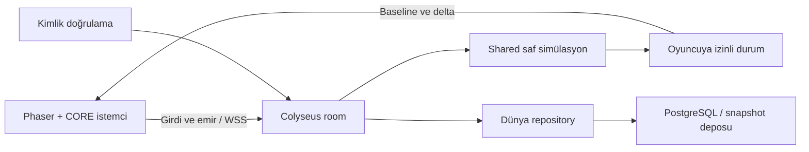

# Çok oyunculu backend kararı: Colyseus, ArcNet ve alternatifler

Araştırma tarihi: **12 Ekim 2026**; ilk belge tabanı `69aac367`, ikinci inceleme `22577f4f`.
İncelenen oyun modelleri: Mindustry benzeri co-op/PvP otomasyon, bullet hell/mini MOBA ve
açık dünya RTS. Network bu repoda **tek bir oyunun değil monorepo'nun** altyapısıdır
([`@volstudio/network`](../network/README.md)); bu belge o altyapının framework, işletim ve maliyet
gerekçesidir. Toplam eşzamanlı oyuncu, dünya büyüklüğü ve barındırma bütçesi ölçülmeden
sabitlenmez.

## Güncel hüküm

**Colyseus 0.18 üzerinde sunucu otoriteli TypeScript simülasyonu** seçilidir; oda sınıfı,
kurallar ve dünya durumu oyuna, bağlantı sözleşmesi ve sunucu çalışma zamanı network paketine
aittir. Seçim yerel deneyle (gerçek Node odası, 12 gerçek istemci, Phaser 4, Chromium ve WebKit)
desteklenir; bu **üretim kapasitesi kabulü değildir**: üretim donanımı, gerçek ağ kaybı ve
gecikmesi, uzun koşu, paketli uygulama ve kimlik/WSS ayrıca ölçülüp kabul edilir. Ölçüm kapısı
aşağıda “7/24 dünya” bölümündedir.

Çok oyunculu dağıtım yalnız **resmî sunucuyu** destekler; oyuncunun sunucu açması dağıtım hedefi
değildir. Platform hedefi **Windows, Linux ve Android**; Steam dağıtımı hedefte, web yayını kapsam
dışıdır. Chromium/WebKit deneyleri web ürünü desteği değil, native webview entegrasyonu öncesi sınırlı
teknik kanıttır. Steam kimlik akışı ve Android hesabının Steam ile ilişkisi kararlaştırılmadı.

Bir dünyayı bir otoriter oda olarak çalıştırmak başlangıç modelidir; çok dünya gerektiğinde
süreç sayısı ve eşleştirme ölçüyle büyütülür. 24 oyuncu küçük bir bağlantı sayısıdır; asıl yük
oyun simülasyonundan (fabrika makineleri, yapay zekâ, birimler, mermiler) ve istemciye giden durum
hacminden gelir. Backend seçimi bu algoritmaların maliyetini kendiliğinden çözmez.

**Talo'yu ana oynanış sunucusu olarak seçmiyorum.** Gerçek WebSocket/kanal özellikleri vardır; fakat
araştırılan hazır sözleşme oyun kuralları, tick, otoriter savaş/üretim ve istemci düzeltmesi sağlayan
bir runtime değildir. Talo hesap, Steam entegrasyonu, kayıt ve canlı işletim ihtiyaçları için ayrıca
değerlendirilebilir. [Socket istekleri](https://docs.trytalo.com/1.x/sockets/requests),
[kanal mesajı kaynak kodu](https://raw.githubusercontent.com/TaloDev/backend/develop/src/socket/listeners/gameChannelListeners.ts).

## 12 Ekim 2026 ikinci tur: kaynak, uygulama ve maliyet kararı

**Sorunun asıl şekli:** 12 oyuncuyu bir WebSocket odasına almak teknik açıdan
nispeten kolay; milyonlarca durağan karo, aktif binlerce üretim makinesi,
AI, mermi ve PvP görünürlüğüyle **kesintisiz tek dünya simülasyonu** zordur.
Toplam CCU yerine dünya başına aktif nesne sayısı, her server tick'inde
değişen veri hacmi, istemciye gönderilen ilgilendiği bölge ve kaydın
dayanıklılığı ana maliyet değişkenleridir.

İlk sonuçlara bakıp özel transport yazmıyorum: **Colyseus mevcut
`Simulation`'a adapte oluyor, TypeScript/Node çalışma zamanını koruyor, MIT
lisansı kendi sunucumuzda ücretsiz ve ilk 12 gerçek istemci testi geçti.**
Ancak bu, kalıcı dünya için kesin çerçeve kararı değildir. Dünya modeli
Colyseus'a değil oyun/CORE sınırına aittir; framework değiştirebilmek için
schema/protokol ve depo adapter'ları dar tutulur.

### Anuken kendi ArcNet'ini nasıl kullanıyor?

Mindustry, Java tabanlı Anuken **Arc** altyapısındaki
`extensions:arcnet` modülünü ve varsayılan `ArcNetProvider`'ı kullanır.
Bu, TypeScript/Phaser için hazır bir TypeScript kütüphanesi değildir.
Başlangıçta sıkıştırılmış dünya baseline'ı gönderir; daha sonra blok/entity
snapshot'ları, konum ve görünürlük bilgilerini güvenilir/güvenilmez ağ
kanallarına ayırır. Steam sürümü ayrı Steam Networking Sockets yolu da kullanır.
Dolayısıyla Mindustry'nin yaptığı şey, tek bir ağ kütüphanesi yazmak değil,
**oyunun veri modeli için özelleştirilmiş world streaming ve sync politikasıdır**.
Öğrenilecek taraf budur: chunk sürümü, blok değişiklikleri, görünürlük,
simülasyon zamanı ve az miktarda girdi niyeti. Üstelik NetServer'ın güncel
`clientSnapshot` yolunda `admins.isStrict() && headless` koşuluna göre oyuncu
konumu doğrulanıyor; katı denetim kapalıyken istemci pozisyonu kabul
edilebiliyor. Mindustry'yi mutlak otorite/anti-cheat referansı saymak hatalı.
[ArcNet bağımlılığı](https://github.com/Anuken/Mindustry/blob/master/build.gradle),
[Mindustry Platform](https://github.com/Anuken/Mindustry/blob/master/core/src/mindustry/core/Platform.java),
[NetServer](https://github.com/Anuken/Mindustry/blob/master/core/src/mindustry/core/NetServer.java),
[Steam ağı](https://github.com/Anuken/Mindustry/blob/master/desktop/src/mindustry/desktop/steam/SNet.java).

### Alternatifler: yeni gereksinime göre

| Çözüm                                    | Buradaki avantaj                                                                               | Maliyet ve tasarım sakıncası                                                                                               | Şu anki karar                                                |
| ---------------------------------------- | ---------------------------------------------------------------------------------------------- | -------------------------------------------------------------------------------------------------------------------------- | ------------------------------------------------------------ |
| **Colyseus 0.18 OSS**                    | Saf TS/Node `Simulation`, odalar, schema delta, bağlantı, MTI testleri, kendin barındırma      | Büyük chunk'ı kendisi optimize etmez, 1 room tek JS olay döngüsü, SDK WebKit constructor sorunu (aşağıdaki WebKit bulgusu) | **İlk dikey dilim**; son karar yük testine bağlı             |
| **Kendi ws/uWebSockets protokolümüz**    | Paket formatını/tick/interest'i bütünüyle yönetiriz, ek hosting lisansı yok                    | Reconnect, auth, prediction, snapshot diff, hile sınırı, codec/migration, gözlem ve bakımın tamamı bize ait                | Colyseus transport/codec ölçümü dar boğaz kanıtlarsa         |
| **Colyseus uWebSockets transport**       | Aynı room/sim üzerinde daha ucuz taşıma adayı, az geçiş maliyeti                               | Codec ve sim CPU sorunlarını çözmez; native TLS/perf testi gerekir                                                         | Özel ağ yığını yazmadan önce A/B testi                       |
| **SpacetimeDB 2 TypeScript**             | Kalıcılığı ve tablo aboneliğini framework'ün merkezine alır, artık TS server reducer destekler | Reducer/DB-first world mimarisi için simülasyon refaktörü, BSL 1.1 lisans incelemesi ve TeV bazlı veri trafiği faturası    | Küçük fabrika reducer deneyiyle açık rakip                   |
| **Nakama OSS**                           | Auth, sosyal, sıralama, oturumlar ve server framework                                          | TS runtime Goja/ES5 sandbox; mevcut Node/ES2022 `Simulation`ı doğrudan çalıştıramaz; ek Node gameplay sunucusu gerekir     | İleride hesap/sosyal katman adayı                            |
| **PartyServer/Cloudflare DO**            | Coğrafi yakınlık, stateful actor modeli, entegre edge operasyonu                               | Isolate sınırları, sürekli 60Hz dünya ve büyük RAM yükü, hibernation etkileşimi; hosted PartyKit Ekim 2026 kapanıyor       | Küçük asenkron oda için ayrı deney, bu dünya için önce değil |
| **Godot dedicated server/Photon Fusion** | Engine'de ayrı multiplayer ekosistemleri                                                       | Phaser/CORE TS simülasyonu yeniden yazılır; Fusion Unity odaklıdır                                                         | Mevcut repo için ekonomik değil                              |

[Colyseus optimizasyon](https://docs.colyseus.io/state/optimization),
[Colyseus uWS](https://docs.colyseus.io/server/transport/uwebsockets),
[Colyseus ölçekleme](https://docs.colyseus.io/scalability),
[SpacetimeDB TS reducer](https://spacetimedb.com/docs/quickstarts/typescript/),
[SpacetimeDB fiyat](https://spacetimedb.com/pricing),
[Nakama TS çalışma zamanı](https://heroiclabs.com/docs/nakama/server-framework/typescript-runtime/),
[PartyKit geçiş duyurusu](https://blog.partykit.io/posts/hosted-platform-shutdown),
[Cloudflare DO limitleri](https://developers.cloudflare.com/durable-objects/platform/limits/).

### Gerçek yerel prototip: neler PASS?

`network/` aktif workspace paketi ve `@volstudio/network` exports'udur. `games/vol-test/server/`
Colyseus 0.18 Node odalarını kurar: `MatchRoom` (herkese açık, moda göre eşleşir) ve `PrivateRoom`
(5 harfli kodla). Otorite `Simulation`dır: sunucu 60 Hz sabit adımla koşar, durumu 20 Hz yamalar,
odada 12 (özel odada 8) araç, ileti başına 1 KiB ve saniyede 240 ileti sınırı vardır. Girdi
Colyseus `defineInput` tamponundan adım başına bir kez tüketilir ve tüketilen sayı onay olarak
döner; istemci aracı aynı adım işleviyle öngörür, SDK sunucu durumuna göre yeniden oynatır.

Gerçek `startHost` sunucusu ve SDK istemcisiyle entegrasyon testleri şunları doğrular: katılım,
ad çakışması ve temizliği, protokol reddi, mod başına oda, 13. oyuncunun ikinci odaya düşmesi,
özel oda kurma/katılma/çakışma/eşzamanlı kuruluş, bozuk girdi, ateş olayı, ileti taşmasında
düşürme, skor ve maç döngüsü, bağlantı kopması ve yeniden bağlanma, öngörü sapması (yerel
koşuda uzlaştırmaların çoğunda düzeltme sıfırdır; sunucu girdisi geç kalırsa küçük bir düzeltme
doğar ve testte ayrı sayılır). Ölçüm ve sınırlar `games/vol-test/tests/server/MatchRoom.test.ts`
içindedir.

Bu **üretim kabulü değildir**; şunlar NOT-RUN'dır: çok oyunculu yük ölçümü (CPU, bellek, bant,
yama aralığı) yeni mimaride yeniden alınmadı — önceki prototipin ölçümü sahne ve girdi yolu
değiştiği için kaldırıldı, **paketli (Tauri) Windows, Android ve Linux ağ kabulü**, dış WAN WSS,
iki farklı JS motorunda (V8/JavaScriptCore) öngörü eşitliği, gerçek hesap/Steam kimlik doğrulaması,
kalıcı kayıt ve çok makineli dünya sahipliği. Modelde fabrika/konveyör/TD yoktur.

### Kapasite ve aylık maliyet: varsayımlar açık

Hesap: 730 saat/ay, aktif oyuncu başına **her 50ms 1 kB wire patch**,
bağlantılar %100 dolu, state güncellemeleri her istemciye gönderilir.
TLS/headers, geri giriş, sıkıştırma, ilgi alanı ve backend CPU hariçtir.
Bu bir ölçülmüş trafik kaydı değildir.

| Kapasite             | Tam dolu 1kB/oyuncu/20Hz | %25 efektif doluluk | 4kB/oyuncu/20Hz tam dolu |
| -------------------- | -----------------------: | ------------------: | -----------------------: |
| 1 dünya × 8 oyuncu   |                420 GB/ay |           105 GB/ay |               1,68 TB/ay |
| 1 dünya × 12 oyuncu  |                631 GB/ay |           158 GB/ay |               2,52 TB/ay |
| 20 dünya × 8 oyuncu  |               8,41 TB/ay |          2,10 TB/ay |              33,64 TB/ay |
| 20 dünya × 12 oyuncu |              12,61 TB/ay |          3,15 TB/ay |              50,46 TB/ay |
| 20 dünya × 14 oyuncu |              14,72 TB/ay |          3,68 TB/ay |              58,87 TB/ay |

**CPU ve RAM asıl belirsizlik:** 20 oda × 30Hz × 5ms ortalama sim+encode
yükü saniyede 3 çekirdek-saniyedir; %50 hedef kullanımda ~6 vCPU gerekir.
1ms ise ~1,2; 15ms ise ~18 vCPU. 20 dünya × 256MiB ≈5GiB RAM, ancak
768MiB ise 15GiB + Node/DB/OS/GC. Bu noktalar ölçüm değil duyarlılık
hesabıdır. Her 60Hz tick'in 16,7ms bütçesi vardır ve 20Hz patch kısılması
sim yükünü kendiliğinden azaltmaz.

**12 Ekim açık fiyat karşılaştırması:** Colyseus Cloud Frankfurt High Frequency
1 paylaşımlı vCPU/1GB **$18/ay**, 2 paylaşımlı vCPU/4GB **$72/ay**;
resmî API listesi ve vitrindeki başlangıç $15/ay aynı değil.
Self-host Hetzner Almanya CX23 2vCPU/4GB **€5,49/ay**, CPX22 2vCPU/4GB
**€19,49/ay**; IPv4, %20 backup, vergi ve operasyon dahil değil.
Tek dünya pilotunda örnek Hetzner CX23 + IPv4 + backup yaklaşık **€7,09/ay**
(DB/WSS/reverse proxy/monitoring hariç). 20 dünya orta varsayımsal yükte
Cloud 3×HF2v4GB ≈**$216/ay**, Hetzner 2×CPX32 ≈**€86/ay** + DB;
ağır yükte Cloud 9×HF2v4GB ≈**$648/ay**, Hetzner 3×CPX42
≈**€252/ay** + DB. Bu SKU'ların CPU performansı eşdeğer değildir, fiyat
ürün kapasitesini kanıtlamaz. Colyseus Cloud API 33 lokasyon döndürdü,
Türkiye lokasyonu yok; Frankfurt/Warsaw/Tel Aviv RTT gerçek ISP'lerde ölçülmeli.
[Cloud fiyat API](https://cloud-prod.colyseus.io/api/prices),
[Hetzner Haziran 2026 fiyat güncellemesi](https://docs.hetzner.com/general/infrastructure-and-availability/price-adjustment/),
[Hetzner Cloud](https://www.hetzner.com/cloud/general-purpose/),
[DO Droplet ve trafik](https://www.digitalocean.com/pricing/droplets),
[SpacetimeDB tarifesi](https://spacetimedb.com/pricing).

### 7/24 dünya neden başka bir sözleşme gerektiriyor?

Arka planda hiç oyuncu yokken 60Hz çalışan 20 world ile hiç oyuncu yokken
uyuyup birikmiş üretimi analytically catch-up eden dünya aynı CPU faturası
değildir. PvP/TD tehditleri 7/24 ilerleyecekse tam sim gereken nesneleri
tanımlamak gerekir. Üretim çözümü: dünya başına **tek writer ve lease/fencing**;
tekil komut ID/idempotent ledger; checkpoint'te entity ID, RNG, tick,
cooldown, fabrika ağı, inventory ve chunk revisions; journal işlemine
kalıcı fsync/transaction olmadan ACK gönderilmez. PostgreSQL aday,
snapshot/yedek nesne deposu ayrıdır. Bugünkü maç odası RAM'de çalışır ve bunları sunmaz; kalıcı
dünya bu sözleşmeyi karşılayan ayrı bir oda ve depo adapter'ı ister.

Ölçüm kapısı: 1/5/20 dünya × 8/12/14 gerçek client, farklı 30/60Hz
sim ve 10/20Hz patch, 0,25/1/4kB payload ve 0/25/100% world aktivitesi.
Tick/encode/GC p50/p95/p99, event-loop lag, RSS, CPU, outbound byte,
oyuncu net RTT/jitter ölçülür; **24–72 saat soak**, oyuncu kopması,
%1–3 kayıp/50–200ms gecikme, process kill, DB arızası, migrate/restore,
Windows WebView2/Android/Linux WebKitGTK paketli denemeler ayrıca kabul alır.
İlk 30Hz p99 yük hedefi 33,3ms ve %95 için 20ms adaydır; ürün ölçümü sonrası
`quality.json` kapısına geçirilir. Bu veri gelmeden hosting satın alma
veya yeniden `arcNet` yazma kararı verilmez.

## Colyseus nedir; sunucu satın almak gerekir mi?

Colyseus bir oyun motoru değil, çok oyunculu oyun için **sunucu framework'ü
ve istemci SDK'sıdır**. Node.js üzerinde bizim yazdığımız TypeScript oyun
kurallarını çalıştırır; oyuncuları odalara alır, yetkili durumu istemcilere
eşitler ve bağlantı yaşam döngüsünü yönetir. Phaser çizer, CORE ortak
mekanizmaları sağlar, Tauri ürünü paketler. İnşa maliyeti, üretim ağı,
mermi çarpışması, takım ve hasar kuralını Colyseus bizim yerimize tasarlamaz.
[Framework](https://docs.colyseus.io/), [rooms](https://docs.colyseus.io/room).

`0.18` sürüm ailesidir; bütün paketlerin tam sürümü `0.18.0` veya aynı
son ek değildir. Deneyde core `0.18.18`, SDK `0.18.5`, transport `0.18.4`
ve schema `5.0.39` kullanıldı. Core/transport Node 22 ve üstünü ister;
reponun Node 22.23.1 tabanı denemeyi çalıştırdı. Üretimde bu sürümler kilitlenir,
güvenlik güncellemeleri sözleşme testinden geçirilir.

**Çok oyunculu oynarken bir sunucu programı çalışmalıdır; ayrı fiziksel
sunucu veya mini PC satın almak zorunlu değildir.** Sunucu, dünyanın doğru
haline karar veren programdır. Bu program geliştirme bilgisayarında,
bir oyuncunun bilgisayarında, kiralık sanal makinede veya yönetilen Cloud'da
çalışabilir. Monorepoda kaynak kodunun bulunması ile internetten erişilebilir
sunucunun işletilmesi iki ayrı iştir. Masaüstü oyununun dağıtılması,
kendiliğinden herkese açık oyun sunucusu açmaz.

| Kullanım                          | Program nerede çalışır?                               | Oyuncular açısından sonuç                                                     |
| --------------------------------- | ----------------------------------------------------- | ----------------------------------------------------------------------------- |
| Geliştirme                        | Mevcut bilgisayarda Node; oyun aynı makinede          | Donanım veya ücretli hizmet almadan başlanır; bu araştırma böyle koştu        |
| Ev/LAN co-op                      | Mevcut bilgisayar ya da isteğe bağlı mini PC          | Aynı yerel ağdan erişim; host kapanınca canlı dünya durur                     |
| Oyuncunun açtığı internet dünyası | Oyuncunun makinesinde sunucu veya ayrı headless paket | NAT, CGNAT, adres bulma ve güvenli erişim çözülür; dünya hosta bağlıdır       |
| Herkesin eriştiği resmî co-op/PvP | VPS veya Colyseus Cloud                               | Geliştirici bilgisayarından bağımsız uptime; işletim ve kayıt maliyeti vardır |

Tablo teknik barındırma seçeneklerini karşılaştırır; onaylanan ürün kapsamı
yerel geliştirme ve resmî sunucu dağıtımıdır. Ev/LAN ve oyuncu hostu seçenekleri
ürün özelliği taahhüdü değildir.

İlk ürün için önerim: **önce mevcut bilgisayarda geliştir, kapalı internet
testinde yönetilen Cloud veya küçük VPS kullan; ölçüm olmadan mini PC alma.**
PvP'de resmî güvenilir sunucu daha sağlam otoritedir. Oyuncu hostu kendi
sunucu kodunu değiştirebilir; onun sonucu doğrulanmış ranked sonuç sayılmaz.
Evden sunucu açmak mümkündür fakat upload, elektrik, router/firewall,
TLS, yeniden başlatma ve harici yedek sorumluluğu getirir. CGNAT altında
yalnız router port yönlendirmesi yeterli olmayabilir; erişilebilir servis,
uygun tünel veya sağlayıcı desteği gerekir.
[NAT mekanizması](https://tailscale.com/blog/how-nat-traversal-works),
[self-host dağıtımı](https://docs.colyseus.io/deployment).

Oyuncular çıktıktan sonra dünya davranışı henüz seçilmedi. Kaydet/durdur
modeli küçük co-op için başlangıç önerimdir; yeniden girişte restore edilir.
7/24 çalışan dünyada sunucu oyuncusuzken de simülasyon sürer ve kayıt alır.
Offline üretimi süre farkından hesaplamak üçüncü seçenektir; üretim/tüketim
ve kapasite kuralları ayrıca tanımlanır. Bunlar Colyseus lisans planları değil,
ürün kurallarıdır. `autoDispose: false` canlı boş odayı koruyabilir;
süreç çökmesi sonrası geri yüklemeyi veya otomatik yedeği sağlamaz.

Boş dünyayı kaydedip durdurmak CPU/RAM işini azaltabilir; kiralık instance
yerinde duruyorsa sabit aylık ücret kendiliğinden sıfırlanmaz. Otomatik
uyku/yeniden açma ayrı ürün ve dağıtım işidir; Cloud'un mevcut manual plan
yönetimine böyle bir özellik atfedilmedi.

## Yöntem ve gerçek kanıt

Resmî dokümanlar, güncel npm metadata'sı ve resmî kaynak depoları karşılaştırıldı.
Graphify `query`/`affected` ile bulunan ilişkiler kaynakla doğrulandı.
Pencil kaynağına erişilmedi. Üretim kodu, dependency manifesti ve repo kilidi
değiştirilmedi; deney vitrinin git dışı records alanında ayrı bir
backend-research dizininde kuruldu. Rapordaki mimari seçimler **öneri**, doküman özellikleri
**kaynak bilgisi**, yerel sonuçlar **ölçülen kanıt** olarak okunmalıdır.

Bu araştırmanın deney kaynakları, kilidi ve kayıtları **yerel kanıt** olarak
git dışında tutulur; temiz klonda yeniden üretilebilir deney paketi teslim edilmez.
Kalıcı VOL.TEST entegrasyonunda protokol, ownership, reconnect, input bütçesi,
kalıcılık ve WebKit regresyonları izlenen kaynak/test ağacına alınır ve repo
kapılarında doğrulanır. Araştırma harness'ı üretim kodu olarak taşınmaz.
Browser derlemesi deney dizininin git dışı dist alanına yazılır; mevcut
üretilen çıktı sınırı kullanılır, lint veya test kapsamı daraltılmaz.

### Çalıştırılan deneyler

| Deney                                         | Sonuç                                                                                                                                       | Kanıtın sınırı                                                                                                   |
| --------------------------------------------- | ------------------------------------------------------------------------------------------------------------------------------------------- | ---------------------------------------------------------------------------------------------------------------- |
| Mevcut `headless.test.ts`                     | 2/2 PASS; gerçek Node çocuğu ile test sürecinin beş seedli senaryosu eşleşir                                                                | Chromium/WebKit/Android arasında bit eşitliği testi değildir                                                     |
| Güncel Colyseus + gerçek VOL.TEST simülasyonu | Node 22.23.1; 24 gerçek WebSocket istemcisi, 24 gerçek araç; 24 girdi ACK; hareketin schema ile eşitlenmesi PASS                            | Tek makine, loopback, kısa bağlantı/entegrasyon deneyi                                                           |
| Olumsuz kontrol                               | Aralık dışı hareket girdisi reddedildi; 25. istemci aynı odaya alınmadı                                                                     | Girdi doğrulayıcısı deneyde bizim yazdığımız koddur; framework bütün oyun kurallarını hazır doğrulamaz           |
| Genişletilmiş sunucu entegrasyonu             | 12/12 kontrol; üç bağımsız koşu da çıkış kodu 0 ve hatasız kapanış                                                                          | Küçük hareket/ekonomi modeli; Steam auth ve tam dünya codec'i yok                                                |
| Phaser 4.2.1 + Chromium 151                   | Vite browser build, iki oyuncu, prediction, sunucu düzeltmesi, kopma/toparlanma, dispose ve CSP kontrolleri PASS                            | Loopback HTTP/WS; paketli Tauri ve gerçek ağ bozunumu değil                                                      |
| Phaser 4.2.1 + WebKit 26.5                    | Aynı oynanış kontrolleri PASS; **hata kaydı olmayan kabul FAIL**                                                                            | SDK constructor kaynaklı iki protocol error; detay aşağıda, hata filtrelenmedi                                   |
| Kontrollü gecikme, iki browser                | Her yöne 100 ms TCP proxy gecikmesi; echo Chromium 211,8 ms, WebKit 241 ms; correction/reconnect/temizlik geçti; input replay sayıları 7/8  | Küçük hareket modeli; WS/HTTP, paket kaybı/jitter veya gerçek internet değil; WebKit temiz hata kabulü yine FAIL |
| Kötüye kullanım kontrolleri                   | Sınırsız input tüketiminde hız bütçesi aşımı bulundu; tek input/adım kontrolü, ayarlanmış mesaj limiti ve 8 KiB üstü paket reddi doğrulandı | Framework varsayılanları kendi başına hile koruması değildir; küçük modelde sınır deneyi                         |
| SDK'sız taşıma kontrolleri                    | İki motorda dört ayrı kontrol; native WS açıldı/kapandı, invalid constructor yakalandı, fallback açıldı                                     | WebKit invalid constructor'ı catch edilse de Playwright pageerror olarak kaydetti                                |
| Yerel dependency advisory taraması            | İzole deney kilidinde `npm audit --omit=dev --json`: toplam 0 advisory; çıkış 0                                                             | Kod denetimi veya gelecekte açık çıkmayacağı garantisi değil; üretim lock kabulü değil                           |

İlk deneme manifestinde diğer paketle aynı sanılan `ws-transport` sürümü
yayımlanmamıştı; npm ETARGET verdi. Paketler ayrı sorgulanıp aşağıdaki
gerçek sürümlerle kuruldu; son deney çıkış kodu 0'dır. Paket sürümlerinin
son eklerinin eşit olması gerekmiyor.

| Deneyde kurulan paket    | Sürüm   | Runtime                                                          |
| ------------------------ | ------- | ---------------------------------------------------------------- |
| `@colyseus/core`         | 0.18.18 | Node ≥22                                                         |
| `@colyseus/sdk`          | 0.18.5  | Paket engine kaydı Node ≥12; gerçek hedef webview ayrıca sınanır |
| `@colyseus/schema`       | 5.0.39  | Schema 5 ailesi                                                  |
| `@colyseus/ws-transport` | 0.18.4  | Node ≥22                                                         |

Yeniden koşma (git dışı deney kaynakları ve kurulu bağımlılıklar mevcutsa):

```sh
pnpm --filter @volstudio/vol-test exec vitest run tests/sim/scenarios/headless.test.ts
pnpm exec tsx --tsconfig games/vol-test/tsconfig.json devtools/vol-showcase/records/backend-research/probe.ts
pnpm exec tsx --tsconfig games/vol-test/tsconfig.json devtools/vol-showcase/records/backend-research/integration-suite.ts
pnpm exec tsx --tsconfig games/vol-test/tsconfig.json devtools/vol-showcase/records/backend-research/browser-suite.ts
pnpm exec tsx --tsconfig games/vol-test/tsconfig.json devtools/vol-showcase/records/backend-research/measurement.ts
pnpm exec tsx --tsconfig games/vol-test/tsconfig.json devtools/vol-showcase/records/backend-research/abuse-probe.ts
```

Sunucu deneyi `tsx` ile çalıştı; yeni backend'in tam TypeScript/deployment
build kabulü değildir. Browser fixture gerçek Vite build'inden servis edildi.
Yetkili Steam girişi, TLS/WSS, paket kaybı/jitter ve gerçek internet, fiziksel/paketli webview,
tam dünya restore/migration ve uzun süreli ürün yükü **NOT-RUN**.
CSP kontrolü browser HTTP/WS açık listesidir; native CSP kabulü değildir.
Bu sonuçtan “24 oyunculu ürün hazır” çıkarılamaz.

Gecikmeli koşu aynı browser komutuna `VOL_RESEARCH_DELAY_MS=100` ortam
değeriyle yapıldı. TCP proxy byte akışını iki yönde 100 ms geciktirdi;
gerçek paket kaybını byte silerek taklit etmedi. Bekleyen input'un replay
edildiği de sayıldı; uzun oturum ve karmaşık fizik rollback'i değildi.

### 12 sunucu kontrolü neyi kanıtlıyor?

1. Yanlış deney credential'ı reddedildi; bu oyuncu tarafından verilen
   kimliği güvenilir yapan bir production auth değildir.
2. 24 gerçek SDK istemcisi tam oda durumunu aldı; 25. istemci reddedildi.
3. `StateView` içindeki özel alan yalnız sahibine gitti; diğer 23 istemcide yoktu.
4. Başkasının aktör adına inşa emri reddedildi; aynı işlem ikinci kez
   kaynak tüketmedi. Aktör eşlemesi sunucu bağlantı verisinden okundu.
5. NaN/aralık dışı hareket, input sanitizer sonrasında sonlu ve sınırlı kaldı.
6. WS üzerinden `.unreliable()` alanı ilk baseline'da kaldı; reliable tick
   ilerledi. **Bu bir olumsuz kontrol PASS'idir; alanın çalıştığı iddiası değildir.**
7. Gerçek socket `terminate()` sonrası SDK otomatik bağlandı; aynı koltuk
   ve bağlantı verisiyle mesaj alışverişi sürdü.
8. Yanlış reconnect token reddedildi; ardından doğru token aynı koltuğu aldı.
9. İkinci odanın ekonomisi birinci odadan ayrıldı.
10. Rızalı ayrılma oyuncuyu kaldırdı ve boş oda dispose edildi.
11. Onaydan önce dosyaya yazılıp flush edilen küçük ekonomi işlemi, gerçek
    Node çocuk süreci öldürülüp yeniden açılınca korundu. Tekrar emir
    aynı kaynak/işlem sonucunu verdi; ikinci inşa oluşturmadı.
12. Açık odalar temizlendi; oluşturma/dispose sayısı eşleşti; port yeniden açılabildi.

Çökme testi **yalnız küçük domain snapshot'ıdır**. PostgreSQL/SQLite,
tam fabrika, RNG/timer restore, eşzamanlı writer, disk hatası veya elektrik
kesilmesi kabulü değildir. Windows'taki `SIGKILL` süreç sonlandırır; gerçek
makine güç kaybını simüle ettiğimizi söylemiyoruz. Dosya örneği ürün kayıt
adapter'ı olarak taşınmamalıdır. Kapanışta `allowReconnection` bekleyişi
başlangıçta fire-and-forget bırakıldığı için reject üretti; deney handler'ı
bekleyip normal timeout/kapanışı ele alacak şekilde düzeltildi. Üç temiz
tekrar **bu düzeltmeden sonraki** koşulardır.

### WebKit bulgusu ve çapraz kontrol

Yayımlanmış SDK 0.18.5 önce `WebSocket(url, optionsObject)` dener; hata
yakalanınca doğru browser signature'ına döner. Browser'ın ikinci argümanı
Node seçenek nesnesi değil subprotocol'dür. WebKit geçersiz protocol için
catch'ten önce JS error console kaydı oluşturur; Playwright WebKit adapter'ı
bunu `pageerror` olarak raporlar.
[Sürüme bağlı SDK kaynağı](https://github.com/colyseus/colyseus/blob/%40colyseus%2Fsdk%400.18.5/packages/sdk/src/transport/WebSocketTransport.ts),
[WebSocket standardı](https://websockets.spec.whatwg.org/#dom-websocket-websocket),
[WebKit kaynağı](https://github.com/WebKit/WebKit/blob/main/Source/WebCore/Modules/websockets/WebSocket.cpp),
[Playwright adapter'ı](https://github.com/microsoft/playwright/blob/main/packages/playwright-core/src/server/webkit/wkPage.ts).

SDK/Phaser yüklenmeyen ayrı sayfalarda native constructor ve ikinci argümanı
`undefined` olan constructor temiz bağlandı. Seçenek nesnesi `SyntaxError`
ile yakalandı; WebKit yine error kaydı verdi. SDK ile aynı try/fallback
kontrolü de bağlandı fakat aynı kayıt kaldı. Bütün kontrollerde
`window.error` ve `unhandledrejection` boştu. Bu, iki motordaki farkın
oyun simülasyonundan gelmediğini doğruluyor; hatayı sessizce filtrelemedik
ve SDK'yı monkeypatch etmedik.

Sonuç (12 Ekim): **WebKit oynanış geçti, temiz browser kabulü geçmedi.** Bilinen
resmî issue/düzeltme doğrulanmadı. İlgili constructor akışı upstream
düzeltilmeli veya sürüme bağlı, repo yama politikasına uygun dar düzeltme
gerçek regresyonuyla kabul edilmeli; paketli WebKitGTK/Deck ayrıca sınanmalı.
Bu sınırlı transport sorunu, daha büyük simülasyon taşıma maliyeti olan
alternatife geçmek için tek başına yeterli gerekçe değildir.

### Ölçülen maliyet; kapasiteyle karıştırılmamalı

Node 22.23.1 / Windows x64 üzerinde iki ayrı mikro ölçüm yapıldı.
Bunlar kiralık sunucu, hedef cihaz veya birlikte çalışan bütün ürün ölçümü değildir.

| İş                                                                           | Gerçek sonuç                                                                                                                                                        | Ölçülmeyen kısım                                                                                                   |
| ---------------------------------------------------------------------------- | ------------------------------------------------------------------------------------------------------------------------------------------------------------------- | ------------------------------------------------------------------------------------------------------------------ |
| Gerçek VOL.TEST fiziği, 24 araç sürekli hareket/ateş; 600 ısınma + 1800 adım | 60 Hz'in 30 saniyelik simülasyon zamanı; adım p50 0,4336 ms, p95 0,7854 ms, p99 1,3089 ms, max 3,5649 ms; en çok **27** eşzamanlı mermi, mevcut pool kapasitesi 256 | 30 saniye duvar saati soak değil; 2K mermi, fabrika/AI, encoder/ağ/render aynı ölçüme dahil değil                  |
| 10K sentetik schema nesnesi; her patch 2K inventory alanı değişti, 100 patch | Baseline 307.750 byte / 39,99 ms; delta 17.620 byte; encode p50 0,0964 ms, p95 0,4728 ms, p99 1,1922 ms; decoder round-trip doğru                                   | Bunlar gerçek makineler/üretim grafı değil; StateView, 24 gerçek istemci decode'u, TLS, compression ve GC soak yok |

Encoder ilk baseline sırasında varsayılan buffer'ı büyüttüğünü uyardı;
başarısız veya sessizce kayıp baseline değildi. Büyük join burst'ü ve
buffer/bellek bütçesi yine ayrıca kabul edilmelidir. 10K nesne sayısı
“10K makine üretim kabulü” olarak yazılmaz.

**Ölçülen delta boyutundan türetilen, ağdan ölçülmemiş hesap:** 17.620 byte ×
20 patch/sn × 24 oyuncu = **8,458 MB/sn**, yaklaşık **30,45 GB/saat**
çıktı; bütün oyunculara aynı değişim gönderilirse. İlk baseline, protokol/TLS
başlıkları ve compression hariçtir. Gerçek ürün için chunk/interest ve
değişim sıklığı tasarlamadan “24 kişi az, trafik önemsiz” denemez.

## Repo ile uyum ve eksikler

| Alan                  | Bugünkü kaynak kanıtı                                                                                                                   | Backend açısından sonuç                                                                                                                      |
| --------------------- | --------------------------------------------------------------------------------------------------------------------------------------- | -------------------------------------------------------------------------------------------------------------------------------------------- |
| Başsız simülasyon     | [Simulation.ts](../games/vol-test/src/sim/Simulation.ts), [headless testi](../games/vol-test/tests/sim/scenarios/headless.test.ts)      | Simülasyon Phaser bilmez; aynı TypeScript mekanizmaları Node sunucusunda çalışabiliyor                                                       |
| Çoklu araç ve komut   | [command.ts](../games/vol-test/src/sim/command.ts), Simulation `CommandSource`, kimlikli `Vehicle`                                      | Oyuncu niyetini simülasyona aktarmak için başlangıç var; ağ oyuncusu → yetkili entity eşlemesi eklenmeli                                     |
| Simülasyon saati      | [SimulationClock.ts](../core/src/time/SimulationClock.ts), [WorldScene.ts](../games/vol-test/src/scenes/WorldScene.ts)                  | CORE varsayılanı kısmi adım üretebilir; gerçek oyun `partialStep: 'defer'` kullanıyor. Ağ simülasyonu sabit adımı korumalı                   |
| Rastgelelik           | [random.ts](../core/src/random/random.ts)                                                                                               | Durum aktarılabilir RNG var; bütün dünyayı ve her bağımsız RNG akışını eksiksiz kaydetmek ayrıca gerekir                                     |
| Sunucuya uygun import | [CORE exports](../core/package.json), [Phaser sınırı](../core/docs/phaser-boundary.md)                                                  | `math`, `physics`, `time`, `random`, `spatial` alt yolları kullanılmalı; DOM/sunum taşıyan kök barrel sunucu başlangıcı olmamalı             |
| Kalıcılık             | [scopedStores.ts](../tauri-v2/src/adapters/scopedStores.ts), [scopedStorage.ts](../core/src/persistence/scopedStorage.ts)               | `synced` bugün native dosya + Steam Auto-Cloud düzenidir; browser fallback localStorage'dır. Multiplayer dünya/veritabanı otoritesi değildir |
| Büyük dünya kaydı     | [native tasarım](../tauri-v2/DESIGN.md)                                                                                                 | Native store ve Steam Cloud komutları 1 MiB sınırına sahip. Büyük dünyayı buraya sığdırmak için güvenlik sınırı kaldırılmaz                  |
| Ağ istemcisi          | CORE/oyun/kabuk runtime ve lock taraması                                                                                                | Colyseus/Talo/Nakama/SpacetimeDB istemcisi veya ortak multiplayer protokolü mevcut değil                                                     |
| Uzak bağlantı         | [ürün CSP](../games/vol-test/src-tauri/tauri.conf.json) `connect-src`                                                                   | Şu an yalnız self/IPC; ürünün gerçek HTTPS/WSS uçları açık listeyle eklenmeli. Tarayıcı probu paketli Tauri kabulü yerine geçmez             |
| Steam kimliği/taşıma  | [steamworks.ts](../tauri-v2/src/platform/steamworks.ts), [service.rs](../tauri-v2/plugins/vol-steamworks/src/service.rs)                | Input/Cloud yüzeyi var; giriş ticket'ı, lobby ve SteamNetworkingSockets yüzeyi yok                                                           |
| Dünya geri yükleme    | Simülasyon/world/combat kaynak taraması                                                                                                 | Tam dünya snapshot codec'i, restore, ağ baseline ve rollback sözleşmesi yok; yalnız son poz digest'i bunların yerine geçmez                  |
| Workspace sahipliği   | [pnpm-workspace.yaml](../pnpm-workspace.yaml), [layers.mjs](../scripts/quality/layers.mjs), [tsconfig](../games/vol-test/tsconfig.json) | Backend paketi eklemek bugün sıfır yapılandırma değildir; sunucu/shared kaynakları ve gate kapsamı bilinçli tanımlanmalı                     |

Nakama tarafında önemli bir uyum farkı vardır: repo ES2022, ESM, `Map` ve
modern standart kütüphane kullanır. Nakama'nın resmî TypeScript runtime
sözleşmesi Goja/ES5, Node/browser API yokluğu ve sandbox sınırlarını taşır.
Sadece TypeScript kullanıyor olması mevcut simülasyonun doğrudan taşınacağını
kanıtlamaz; ayrı bundle/polyfill ve runtime kabulü veya harici Node simülasyonu
gerekir. [Nakama TypeScript runtime](https://heroiclabs.com/docs/nakama/server-framework/typescript-runtime/).

## Aday karşılaştırması

Tablo bu repo ve 24 kişilik oyun hedefi için mühendislik değerlendirmesidir;
ölçülmemiş performansa sayısal puan verilmedi.

| Aday                       | Oynanış otoritesi                                                                         | Hazır hesap/meta hizmetleri                                            | Repo ile sürtünme                                                               | Bu hedefte karar                                            |
| -------------------------- | ----------------------------------------------------------------------------------------- | ---------------------------------------------------------------------- | ------------------------------------------------------------------------------- | ----------------------------------------------------------- |
| Colyseus 0.18              | Kendi Node/TS kurallarını room içinde koşturur; durum eşitlemesi ve yeni netcode araçları | İsteğe bağlı auth/database/admin; kapsam ve olgunluk ayrıca doğrulanır | En düşük: Node 22 + TS + başsız simülasyon                                      | **Birinci tercih**                                          |
| Talo 1.6.2                 | Socket/kanal iletişimi var; hazır oyun tick/otorite runtime'ı kanıtlanmadı                | Steam, hesap, saves, stats, leaderboard, config/analytics              | Özel TS istemci adapter'ı; self-host backend ayrı Node 24 ve veri servisleri    | Meta servis adayı; tek başına PvP simülasyon seçimi değil   |
| Nakama                     | Authoritative match handler veya harici headless sunucu                                   | Hesap, sosyal, storage, matchmaking ve leaderboard kapsamı güçlü       | Sandbox ile mevcut modern TS simülasyonu arasında fark; veya iki sunucu katmanı | Sosyal/ranked hizmetler erken zorunluysa ikinci tercih      |
| SpacetimeDB 2.0            | Reducer/tablo değişimi + gerçek zamanlı subscription                                      | Kimlik ve kalıcı veri temelinden özel sistemler kurulabilir            | Simülasyonu mutable nesnelerden tablo/transaction modeline taşıma               | Kalıcı dünya önceliği çok güçlenirse deney adayı            |
| Özel Node + `ws`/Socket.IO | Tam kontrol; bütün oyun protokolünü bizim yazmamız gerekir                                | Biz kurarız                                                            | TS reuse kolay; sync/prediction/reconnect/güvenlik bakımı yüksek                | Colyseus'un ölçülen darboğazı veya protokol gereği çıkarsa  |
| SteamNetworkingSockets/SDR | Native taşıma; oyun otoritesi ve simülasyonu yine bize ait                                | Steam platform hizmetleri; genel cross-platform backend değildir       | Yeni Rust/JS IPC, ticket ve taşıma adaptörü                                     | Steam ağırlıklı oyuncu-hosted co-op için koşullu alternatif |

Nakama gerçekten authoritative multiplayer sağlar; bunu Talo ile aynı
kategoriye indirgemek yanlış olur. Oyuncuların hangi maça gireceği ve harici
headless sunucu filosunun yönetimi de belgelenmiştir. İki katmanlı
Nakama + Node simülasyonu teknik olarak makuldür; ilk ürün için ek dağıtım
ve kimlik maliyeti vardır. [Authoritative multiplayer](https://heroiclabs.com/docs/nakama/concepts/multiplayer/authoritative/),
[harici sunucu koordinasyonu](https://heroiclabs.com/docs/nakama/concepts/multiplayer/session-based/).

SpacetimeDB'nin güncel sürümünde **TypeScript sunucu modülü vardır**;
“yalnız Rust/C#” değerlendirmesi bayattır. Reducer değişiklikleri transaction
olarak uygulanır, istemci sorgulara abone olur; memory + commit-log modeli
kalıcı dünya için ilgi çekicidir. Ancak bizim simülasyon nesneleri, pool,
timer ve snapshot sahipliği yeniden modellenir. Her mermi hareketinin
tablo/abonelik maliyeti gerçek yükte sınanmalıdır. Lisansı MIT değildir:
BSL 1.1 kaynak erişimi ve sonradan AGPL/linking exception sözleşmesi ayrı
değerlendirilmelidir. [Dil desteği](https://spacetimedb.com/docs/intro/language-support/),
[reducers](https://spacetimedb.com/docs/functions/reducers/),
[transaction](https://spacetimedb.com/docs/databases/transactions-atomicity/),
[mimari/lisans FAQ](https://spacetimedb.com/docs/intro/faq/).

TypeScript desteği V8 tabanlı olsa da reducer'lar arasında modülün global
mutable nesnelerinin korunacağına güvenilmez; kalıcı durum tablo sözleşmesine
taşınır. Bu fark yalnız dil adı karşılaştırılarak gözden kaçırılmamalıdır.

Socket.IO mesaj sırasını korur, fakat varsayılan teslim garantisi at-most-once'dır;
kopma sırasında kayıp için retry/kalıcılık/offset bizim sorumluluğumuzdur.
Taşıma seçimi tek başına oyun protokolü sağlamaz. [Teslim garantileri](https://socket.io/docs/v4/delivery-guarantees/).
SDR de Colyseus WebSocket sunucusunun otomatik önüne bağlanan bir proxy değildir;
Steam'in kendi bağlantı ve ticket API'lerinin uygulanmasını gerektirir.
[Steam Datagram Relay](https://partner.steamgames.com/doc/features/multiplayer/steamdatagramrelay?l=english).

## Colyseus tercihinin güçlü tarafı ve gerçek sınırları

0.18 ile `defineInput`, `setFixedTimestep`, client prediction/reconciliation,
remote interpolation, predicted spawn/event ve lag compensation araçları
eklenmiştir. “Colyseus yalnız state sync yapar, prediction'ın tamamı sıfırdan
yazılır” bilgisi güncel değildir. Buna rağmen repo fiziğini bu sözleşmeye
bağlamak, gerekli state'i kaydetmek ve yeniden oynatılan ses/efekti tek
sefer üretmek ürün işidir. [0.18 geçişi](https://docs.colyseus.io/migrating/0.18),
[prediction](https://docs.colyseus.io/netcode/client-prediction),
[determinism sözleşmesi](https://docs.colyseus.io/netcode/determinism).

SDK'nın yeni `Predict.sim` yüzeyi opaque fizik motorunu bağlayabilir;
otoriteden scalar state'i yeniden kurup input replay yapar. Contact cache,
timer/RNG ve diğer motor iç durumunu tam rollback ring'ine kendiliğinden
koymaz. VOL.TEST'in tam fiziği için gereken snapshot/adopt sözleşmesi
ayrıca geliştirilir; browser deneyindeki küçük saf hareket modeli bunun
yerine geçmez.
[SDK sim reconciler](https://github.com/colyseus/colyseus/blob/%40colyseus%2Fsdk%400.18.5/packages/sdk/src/predict/simReconciler.ts).

Mevcut SimulationClock ve Colyseus saatini aynı simülasyonun iki bağımsız
otoritesi yapmamak gerekir. Sunucuda tek adım sürücüsü, shared saf `step`
ve render tarafında ayrı interpolation kullanılır. Input ve prediction
adım oranı framework sözleşmesiyle eşleşir; ağ state patch oranı ayrı
ayarlanabilir. Deneyde fizik 60 Hz, patch 20 Hz idi; bu oranlar ürün
bütçesi olarak kabul edilmedi. [Sunucu input/fixed timestep](https://docs.colyseus.io/netcode/server-input).

Her room tek sürece aittir. Çok süreç daha fazla **dünya/oda** barındırır;
tek ağır dünyanın simülasyonunu kendiliğinden işlemciler arasında bölmez.
Çok süreçli eşleştirme/presence için resmî Redis yolu vardır.
“24 kişi/dünya” ile “bütün üründe toplam 24 kişi” farklı kapasite sorularıdır.
[Ölçekleme](https://docs.colyseus.io/scalability).

StateView fog-of-war/takım/görüş alanı için kullanılabilir; fakat resmî
belge büyük veri kümeleri için optimizasyon sınırını açıkça söylüyor.
Sadece renderer'da düşmanı gizlemek PvP gizliliği sağlamaz: görünmemesi
gereken state sunucudan gönderilmemelidir. Streaming collection eklemeleri
tick'lere dağıtabilir; güncel API deneysel, sonraki field güncellemeleri
bu bütçeyle sınırlanmaz. Çok büyük fabrika için chunk/baseline/delta
stratejisi ayrıca ölçülmelidir. [StateView](https://docs.colyseus.io/state/view),
[streaming sınırları](https://docs.colyseus.io/state/streaming).

İlk platform tabanı standart **HTTPS/WSS** olmalıdır. WebSocket TCP'dir;
kayıp pakette sıralı teslim gecikmesi aksiyonda hissedilebilir.
Colyseus WebTransport/QUIC ve unreliable kanalı vardır ama resmî uygulama
deneyseldir. WebSocket'te `.unreliable()` state alanları ilk full sync
sonrasında güncellenmez; unreliable input reliable kanala düşer.
WebView2, WebKitGTK ve Android WebView ölçülmeden bu özelliğe bağlanılmaz.
[WebSocket](https://docs.colyseus.io/server/transport/ws),
[WebTransport uyarıları](https://docs.colyseus.io/server/transport/webtransport).

Reconnect oyuncuyu mevcut canlı oturuma geri alabilir. Süreç çökmesi,
world restore ve başka sürece taşıma ayrı sorunlardır; geliştirici reload
kipi production crash recovery sayılmaz. Oda boşalınca dispose olabilecek
oturum ile oyuncusuz da çalışan kalıcı dünya farklı yaşam döngüsüdür.
[Rooms](https://docs.colyseus.io/room),
[reconnection](https://docs.colyseus.io/room/reconnection).

İstemci `await join/create` döndüğünde ilk full state henüz gelmemiş
olabilir; prediction ve sahne kurulumu gerçek baseline hazır olduğunda
yapılır. Bağlantı token'ı oyuncu hesabı değildir; süreç restart'ından sonra
yeniden hesap doğrulama ve world join gerekir. Restart sonrası aynı canlı
room'u otomatik koruduğumuzu iddia etmiyoruz.

0.18'in yeni `@colyseus/database` katmanı auth, saves, leaderboard ve
operasyon hizmetleri sunuyor; SQLite/PostgreSQL seçenekleri ve kendi
veritabanını kullanma yolu var. Bu nedenle “meta özellik için mutlaka
ikinci backend” şartı yoktur. Katman yeni, Drizzle 1.0 RC tabanlıdır;
deneyde kurulmadı. Dünya snapshot/journal işini kullanıcı cloud save API'sine
eşitlemeden kendi domain repository'siyle tanımlamak daha güvenlidir.
[Database](https://docs.colyseus.io/database).

## Talo ne zaman tercih edilir?

Hesap, leaderboard, stats, JSON player save ve canlı config/analitik hazır
olmalı; oynanış yerel veya ayrı güvenilir hostta çalışmalıysa Talo güçlü
adaydır. Özel channels ile party/lobby ve düşük sıklıklı multiplayer
etkileşimleri kurulabilir. Talo'yu yalnız analytics servisi diye küçültmek de,
kanal broadcast'ını PvP simülasyon otoritesi saymak da doğru değildir.
[Genel kapsam](https://docs.trytalo.com/1.x),
[kanallar](https://docs.trytalo.com/1.x/http/game-channel-api),
[oyuncu save sözleşmesi](https://docs.trytalo.com/1.x/http/game-save-api).

Steam ticket doğrulama ve Steam verileriyle eşleşme belgelenmiştir.
Repo'nun native katmanına `GetAuthTicketForWebApi` ömrü/cancel akışı yine
eklenmelidir; istemciden gelen SteamID tek başına güvenilir kimlik değildir.
Publisher key güvenilir sunucuda kalır. [Talo Steamworks](https://docs.trytalo.com/1.x/integrations/steamworks/),
[Steam ticket doğrulaması](https://partner.steamgames.com/doc/webapi/isteamuserauth?l=english).

Talo request verification replay/tampering kontrolleri sunar. İstemcinin
kendi yazdığı skor veya kaynak miktarını imzalaması onun oynanış açısından
doğru olduğunu kanıtlamaz; bu mimari çıkarımdır. Ranked sonuç ve ortak
envanterin yazıcısı güvenilir oyun sunucusu olmalıdır. Admin yetkisi ile
gameplay key/session kapsamları ayrı ele alınır. [Request verification](https://docs.trytalo.com/1.x/http/request-verification),
[Admin auth](https://docs.trytalo.com/1.x/admin/authentication).

Güncel resmî seçenekler Godot, Unity ve custom HTTP/standart socket'tir;
hazır Phaser/TypeScript istemci SDK'sı doğrulanmadı. Talo backend'in
TypeScript olması bunu sağlamaz. Bizim adapter session/socket ticket
yenileme, hata, iptal/reconnect ve kimlik bağlarını sahiplenir.

Resmî self-host compose **MySQL + Redis + ClickHouse** ve reverse proxy
taşır; önerilen Colyseus/PostgreSQL tasarımına ikinci backend olarak
eklendiğinde ayrı SQL/analytics işletimi getirir. Talo 1.6.2 manifesti
Node ≥24 ister. Repo'nun deterministik üretim Node 22 pini bunun için
değiştirilmez; ayrı servis runtime'ı kullanılır.
[Resmî compose](https://raw.githubusercontent.com/TaloDev/hosting/main/examples/caddy/docker-compose.yml),
[manifest](https://raw.githubusercontent.com/TaloDev/backend/develop/package.json).
9 Ekim 2026 tarihli 1.6.2 release taze doğrulandı; genel release listesi
cache'inden eski sürüm çıkması etkinlik hakkında yanlış sonuç doğurabilir.
[Sürüm](https://github.com/TaloDev/backend/releases/tag/1.6.2).

Colyseus + Talo mümkün bir bileşimdir. Seçilecekse tek ana oyuncu kimliği,
token doğrulama/eşleme, world otoritesi, sonuç yazarı ve retry/outbox
sözleşmesi gerekir. Aynı ilerleme hem Steam Cloud hem Talo hem dünya
veritabanına bağımsız yazılırsa çatışma ve çoğaltma riski vardır.
Meta hizmet ihtiyacı bu maliyeti haklı çıkarmıyorsa ilk üründe eklemem.

## Oyun türüne göre ağ modeli

### Mindustry benzeri co-op/PvP otomasyon

Başlangıç modeli: güvenilir sunucu dünyayı ve kaynak ekonomisini sürer;
istemci inşa/sökme/emir niyeti gönderir. Sunucu takım/sahiplik, maliyet,
menzil, yapı bağlantısı ve geçerli hedefi denetler. Hareketli oyuncu için
tahmin, dünya/fabrika için sürümlü chunk ve gerekli delta gönderilir.
Her bant üzerindeki her görsel ürünün her tick wire entity olması gerekmez.

Mindustry'nin resmî NetServer kaynağında dünya gönderimi, entity snapshot,
blok sync, takım/görünürlük ve konum düzeltmesi görülüyor. “Mindustry
gibi” demek saf deterministik lockstep kullanmak zorunluluğu değildir.
Bu inceleme mevcut master kaynak gözlemidir; onların kapasitesi veya tüm
hile sınırları bizim ürüne aktarılmaz.
[Mindustry NetServer](https://raw.githubusercontent.com/Anuken/Mindustry/master/core/src/mindustry/core/NetServer.java).

Lockstep az komutla bant genişliğini düşürür, ancak cross-engine determinism,
geç katılım baseline'ı, yavaş/kopan oyuncu ve sürüm uyumu kararlarını gerektirir.
Repoda lockstep kodu yoktur; seçilirse bu kararlar ölçüyle verilir. **Öneri:** sis gerektirmeyen
co-op/PvE'de kilit adım adaydır; sis veya gizli bilgi gereken PvP'de ve arena oyunlarında sunucu
otoriteli durum eşitlemesi (öngörü + uzlaştırma) kullanılır.

### Bullet hell ve mini MOBA

Otoriter hasar/cooldown/isabet; oyuncuda hareket ve ateş görseli tahmini,
uzak varlıklarda interpolation gerekir. Mermi sayısı ve çarpışma yükü
oyuncu sayısından bağımsız ölçülür. İstemcide aynı yörüngeyi görselleştirmek
için spawn/parametre kullanmak adaydır; gameplay collision sunucuda kalır.
Hitscan rewind sözleşmesi hareket eden her merminin geçmişte bütün dünya
simülasyonunu otomatik geri oynatacağı anlamına gelmez. Mermi/cooldown/
efekt tekrarları için ayrı regresyon gerekir.

### 24 kişilik açık dünya

Bir dünya bir otoriter oda olarak başlayabilir; bölgesel interest ve chunk
kaydı eklenir. Oyuncu yokken dünya duracak mı, offline üretim hesabı mı
yapılacak, yoksa 7/24 simülasyon mu sürecek: bunlar maliyeti ve kaydı
değiştiren ürün kararlarıdır. Açık dünya büyüklüğü tek başına MMO sharding
gerektirmez; tek dünya CPU/bellek sınırı ölçülünce yeniden karar verilir.

Kalıcı kayıt yalnız oyuncu pozları değildir: dünya sürümü, makine/üretim
durumu, inventory, entity kimlik sayacı, RNG akışları, timer/cooldown,
çalışılmış tick ve varsa komut journal'ı birlikte geri yüklenir.
Tek world writer ve restore sırasında sahiplik/fencing, yinelenen komutta
idempotence ve dayanıklı ACK tanımlanır. Dış DB/HTTP beklemesi simülasyon
adımını bloklamaz; durable işlem ancak gerçekten kalıcıysa onaylanır.

## Önerilen repo yerleşimi

Çok sayıda oyunun aynı altyapıyı kullanması için tercih ettiğim hedef,
dar public exports'a sahip **`@volstudio/network` workspace paketi** ve
oyun başına üç açık runtime alanıdır. Bu paket kendi Node/game process'inin
yerine geçmez; bağlantı adapter'ı, sürümlü protokol zarfı, yaşam döngüsü,
yeniden bağlanma ve ortak sunucu işletim mekanizmalarını sağlar. Gerçek
oyun kuralları ve world schema'sı ürün paketinde kalır.

```text
network/
  src/client/       # SDK bağlantısı ve lifecycle; browser'a uygun
  src/protocol/     # sürüm, input/emir zarfı; gizli bilgi taşımaz
  src/server/       # ortak Node lifecycle/auth/telemetry mekanizmaları
games/<oyun>/
  src/              # Phaser/CORE sunumu ve saf oyun simülasyonu
  server/           # ürün room'u, auth politikası, world repository
```

Temel network protokol/istemci paketi ve ilk ürün odası **uygulandı**;
tam server lifecycle/auth/telemetry ve kalıcı dünya henüz tamamlanmadı. Tek oyunla başlayıp yalnız browser bağlantısını paylaşmak
istenirse daha küçük seçenek önerilen `core/src/<network>` alanı ve opt-in `./network`
export'udur; Colyseus room, DB ve oyun auth politikası CORE'a taşınmaz.
Çok oyun için server ortaklığı da hedeflendiğinden ayrı network paketi
tercih ediyorum. CORE oyun/devtool/network tüketmez; network yalnız uygun
CORE mekanizmalarını tüketir, oyun network'ü exports'tan tüketir.

Yerleşim için kaynakla doğrulanan iş kapsamı:

| Repo sözleşmesi                                                                                                                 | Gerekli somut değişiklik                                                                                                                                       |
| ------------------------------------------------------------------------------------------------------------------------------- | -------------------------------------------------------------------------------------------------------------------------------------------------------------- |
| [Kök sözleşme](../AGENTS.md), [yeni oyun sözleşmesi](new-game.md)                                                               | Bugün oyun runtime'ı yalnız CORE/kabuk/dış bağımlılık kullanabilir; yeni iç network paketi için izinli yön metin sözleşmesine de eklenir                       |
| [Workspace](../pnpm-workspace.yaml), [kök kilidi](../scripts/quality/rootEntries.mjs), [lifecycle](../workspace-lifecycle.json) | `packages/*` kökü/glob'u gerekçelendirilir; network aktif paket kaydı ve exports haritası eklenir                                                              |
| [layers](../scripts/quality/layers.mjs), [moduleCycles](../scripts/quality/moduleCycles.mjs)                                    | Paket keşfi ve `network` türü bilinçli eklenir; izinli yönler ve yasak geri kenarlar test edilir; platform türüne sığdırılmaz                                  |
| Aynı paket client/server sınırı                                                                                                 | Mevcut layer kontrolü aynı sahibi erken döndürür; client → ürün server ve shared → client/server yasakları için ayrı negatif kontroller gerekir                |
| [TS tabanı](../tsconfig.base.json), ürün build'i                                                                                | DOM'suz server typecheck, browser typecheck ve ortak saf alan kapsamı ayrılır; kaynak `.ts` CORE exports'ları kontrollü Node bundle/build ile ele alınır       |
| [Browser sınırı](../scripts/vite/browserBoundary.mjs)                                                                           | Mevcut devtool sınırı Phaser'ı da yasaklar; oyuna olduğu gibi kopyalanmaz. Ürün Vite grafında server/DB/Node built-in/sır importu reddedilir; Phaser izinlidir |
| [Kapılar](gates.md), [justfile](../justfile), [quality](../quality.json)                                                        | Ayrı `build:server` komutu tek başına kapıya girmez; aktif ürün build bileşimi, test/coverage ve güvenlik taraması server'ı da kapsar; ratchet düşürülmez      |
| [Yeni oyun rehberi](new-game.md)                                                                                                | Opt-in multiplayer profili; client/server/shared örneği, yerel iki süreç, auth/CSP ve kabul komutları eklenir                                                  |
| Ürün [CSP](../games/vol-test/src-tauri/tauri.conf.json)                                                                         | Gerçek HTTPS/WSS uçları açık listeyle eklenir; bağlantı engellenmesi/izinli bağlantı paketli üründe sınanır                                                    |

Önerilen `src/<client>`, `src/<shared>`, `src/<server>` alanları aynı `src` altında olduğundan bugün
oyun taramasından tamamen kaçmaz; buna rağmen runtime sınırları ve ayrı
build kabulü eksiktir. Üst seviye `shared/server` dizinlerine göre tarama
kapsamını koruyan bu yerleşimi tercih ediyorum.

Oyunlar birbirinin simülasyonunu import etmez; yeni oyun için VOL.TEST
probe'u ürün bağımlılığına dönüştürülmez. Gerçekten ortak saf mekanizma
CORE alt exports'a gider, oyun kuralları ürün shared alanında kalır.
Colyseus server/schema ayrıntıları her oyunun bütün domain modeline
yayılmaz; bir state projection sınırında tutulur. Tarayıcı bundle'ına
server DB/secret paketi girmez. Device ayarları mevcut yerel store'da kalır.



Gelecekte oyunlar ortak **multiplayer yapma yeteneği** kazanır; bütün
oyunlar otomatik online olmaz. Her ürün entity/komut modeli, otoriter
kurallar, snapshot/restore, interest/fog-of-war ve performans bütçesini
tanımlar. İlk ürün bu sözleşmeyi gerçek tüketimle sabitler; sonraki oyunlar
aynı bağlantı/yaşam döngüsü mekanizmalarını yeniden kullanır.

Browser SDK native `WebSocket`/fetch ile bağlanır. Sırf Colyseus için Tauri
HTTP veya WebSocket eklentisi zorunlu değildir; CSP ve sunucu origin politikası
gereklidir. Rust üzerinden ayrı transport seçilirse JS dependency, Rust
kayıt ve capability izinleri birlikte eklenir.
[Tauri WebSocket plugin](https://v2.tauri.app/plugin/websocket/),
[Tauri HTTP plugin](https://v2.tauri.app/plugin/http-client/).

## Barındırma, lisans ve maliyet

### Açık kaynak ve ücretli bölüm

**Colyseus framework'ü MIT lisanslı ve ücretsizdir.** Kendi sunucunda
çalıştırabilir, ticari oyununda kullanabilir ve değiştirebilirsin; dağıtılan
ilgili yazılımda lisans/telif bildirimi korunur. Bu lisans oyun kaynak
kodunu halka açmanı şart koşmaz. Üretim oyunu için Colyseus Cloud aboneliği,
oyuncu başına lisans veya zorunlu gelir payı şartı yoktur.
[Gerçek lisans](https://github.com/colyseus/colyseus/blob/master/LICENSE),
[ücretsiz self-host kapsamı](https://colyseus.io/pricing/).

**Ücretli Colyseus Cloud isteğe bağlı barındırmadır.** Kaynak kodu ve
domain codec'i bizim repoda kalır; Cloud bırakılırsa aynı Node sunucusu
başka yere dağıtılabilir. Ücret, açık kaynak multiplayer özelliğini açmak
için değil kiralanan altyapı/yönetim içindir. Site ayrıca sponsorlara özel
demo/rehber sunuyor; temel framework lisansını değiştirmiyor.

12 Ekim'de fiyat sayfası **15 USD/aydan başlayan** fiyat gösterdi. Aynı gün
resmî hosting fiyat API'si Frankfurt'ta aşağıdaki planları listeledi.
**Vitrin ile API tutarlı değil; tek kesin minimum veya satın alma fiyatı
vaat etmiyorum.** Dashboard/ödeme ekranı görülmedi; vergi, kur ve eklentiler
ayrı kontrol edilir. API bir kamu fiyat kaynağıdır, açılmış müşteri hesabı değil.
[Vitrin](https://colyseus.io/pricing/),
[resmî fiyat API'si](https://cloud-prod.colyseus.io/api/prices),
[plan açıklamaları](https://docs.colyseus.io/cloud/compute-plans).

| Cloud plan örneği                                | API'deki aylık USD | Anlamı                                                                        |
| ------------------------------------------------ | ------------------ | ----------------------------------------------------------------------------- |
| Low Performance, 1 paylaşımlı vCPU / 1 GB        | 12,50              | Resmî doküman geliştirme için öneriyor                                        |
| High Frequency, 1 paylaşımlı vCPU / 1 GB         | 18                 | Üretim için önerilen plan ailesi; 24 oyunculu ürün kapasitesi garantisi değil |
| High Performance Intel, 1 paylaşımlı vCPU / 1 GB | 18                 | Bölge ve plan bulunabilirliği ayrıca kontrol edilir                           |
| High Frequency, 1 paylaşımlı vCPU / 2 GB         | 36                 | Daha fazla RAM, tek ağır room'u kendiliğinden daha çok çekirdeğe bölmez       |
| High Frequency, 2 paylaşımlı vCPU / 2 GB         | 54                 | Birden çok süreç/dünya için ölçümle değerlendirilir                           |
| High Frequency, 2 paylaşımlı vCPU / 4 GB         | 72                 | İlk ürüne bunu satın alma önerisi veya kapasite kabulü verilmedi              |

CCU/DAU/MAU, eşzamanlı/günlük/aylık oyuncu ölçüleridir. Cloud fiyat sayfasının
bu sayılara lisans sınırı koymaması CPU/RAM'in sınırsız olduğu anlamına
gelmez. 24 oyuncu/dünya ve 100 eşzamanlı dünya, 24 toplam oyuncudan farklıdır.

Talo hosted: ücretsiz 10K oyuncu, Team 24,99 USD/ay 100K, Studio
79,99 USD/ay 1M. Bunlar planın oyuncu ölçüsüdür; eşzamanlı 24 kişilik
oyun simülasyonu throughput'u değildir. Self-host backend MIT'dir.
[Talo fiyatı](https://trytalo.com/pricing),
[backend manifesti](https://raw.githubusercontent.com/TaloDev/backend/develop/package.json).
Nakama OSS Apache-2.0; resmî clustering ölçeği Enterprise ürününde ayrıca
sunulur. [OSS lisansı](https://github.com/heroiclabs/nakama/blob/master/LICENSE),
[Enterprise kapsamı](https://heroiclabs.com/enterprise/).

İlk hosted kararda persistent Node süreci, WebSocket timeout/limits,
restart/drain, bölge, DB backup/restore, log/metric ve anti-abuse
koşulları değerlendirilir. Colyseus Cloud ile container destekleyen
VPS/PaaS aynı şey değildir; biri daha az operasyon, diğeri daha fazla
kontrol sağlayabilir. Hedef oyuncu bölgeleri ve gerçek yük belli olmadan
belirli bir VPS boyutunu yeterli diye ilan etmek doğru olmaz.

### Cloud neyi yönetir; neyi doğrulamadık?

Cloud NGINX/PM2, SSL, deploy, log/metric ve bölge seçenekleriyle işletim
yükünü azaltır. Resmî belgede ücretsiz Cloud katmanı ve otomatik ölçekleme
yok; plan yükseltme dashboard'dan yapılır. Compute aylık peşin faturalandırılır;
erken instance silmenin kullanılmayan zamanı hesap kredisi olabilir.
[Managed hosting](https://colyseus.io/cloud-managed-hosting/),
[Cloud dokümanı](https://docs.colyseus.io/cloud),
[faturalama](https://docs.colyseus.io/cloud/pricing-billing).

Fiyat sayfası sınırsız bandwidth derken güncel API dokümanı planın
`transfer_gb` alanını gösteriyor ve egress'in faturalandırılmadığını söylüyor.
Dokümandaki örnek transfer miktarı her fiyat satırına ait garanti değildir;
seçilen planın şartları satın almadan önce doğrulanır.
[Cloud API](https://docs.colyseus.io/cloud/api).
DDoS koruması ek hizmettir; temel planın bütün saldırıları kapsadığı
varsayılmadı. Yayındaki SLA %99,9 host/network hizmetine yöneliktir;
oyun bug'ı veya kalıcı dünya backup/restore garantisi değildir.
[DDoS kapsamı](https://docs.colyseus.io/cloud/ddos-protection),
[SLA](https://cloud-prod.colyseus.io/legal/sla).

Cloud'un yerel disk kapasitesi, redeploy/resize sonrası dosya kalıcılığı,
otomatik DB yedeği/retention ve restore garantisi kamu belgelerinden
kesinleştirilemedi. SQLite dosyasını ephemeral deployment diskine koyup
kalıcı dünya kabulü verilmez. İlk gerçek dağıtımda ayrı dayanıklı depolama
ve geri yükleme deneyi gerekir. Yeni `@colyseus/database` bir kütüphanedir;
her Cloud planında yönetilen PostgreSQL/yedek dahil olduğunun kanıtı değildir.

### VPS, mini PC ve toplam bütçe

VPS kendi Node/Linux sunucumuzu işletmektir. Resmî fiyat karşılaştırması
için DigitalOcean Basic örnekleri: 1 vCPU/1 GiB **6 USD/ay**, 1 vCPU/2 GiB
**12**, 2 vCPU/2 GiB **18**, 2 vCPU/4 GiB **24**. Bunlar farklı donanım/servis
paketleridir; Cloud'la performans eşdeğeri veya en ucuz sağlayıcı sonucu
değildir. Haftalık backup %20, günlük %30 ek ücret örnekleri var; kapalı
Droplet silinene kadar ücretlenir.
[Resmî fiyatlar](https://www.digitalocean.com/pricing/droplets),
[faturalama/backup](https://docs.digitalocean.com/products/droplets/details/pricing/).

VPS'de OS/Node yamaları, firewall, TLS reverse proxy, process restart,
deploy rollback, metric/alert, disk/DB migration, yedek ve restore bize
aittir. İlk kez backend işletirken bu emek farkı önemlidir. Cloud compute
kolaylığı sağlar; domain kaydı, oyun güvenliği ve DB işini tamamen devralmaz.
Toplam bütçe **compute + kalıcı DB/disk + backup + varsa trafik/domain/ek
hizmet + işletim emeğidir**. Yönetilen DB seçmek faturayı büyütebilir;
küçük tek writer için SQLite teknik adaydır, ancak transaction/checkpoint,
disk kalıcılığı ve restore testi olmadan üretim tercihi sayılmaz. Kalıcı
çok dünya hedefinde PostgreSQL önerim sürüyor.

Mini PC, evde kendin barındırmak için isteğe bağlı donanım seçeneğidir;
mevcut bilgisayar da bu işi yapabilir. Model/RAM satın alma önerisi için gerçek dünya yükü,
hedef uptime, upload ve ölçüm gerekli. Daha çok çekirdek, tek room'un
ana simülasyonunu otomatik hızlandırmaz. Ev elektriği ve hat kesilince
oyuncular kopar; aynı cihazdaki tek kopya dünya dosyası backup değildir.

“Colyseus hiçbir serverless ortamda çalışamaz” da doğru bir genelleme değil:
güncel server API'sinde serverless HTTP export'u ve Vercel deneyi var.
Ancak demo çalışması, uzun ömürlü 24 kişilik world/WebSocket kapasitesi,
sticky routing ve kesintisiz kayıt garantisi değildir. İlk kalıcı dünya
için ölçülmüş persistent Node/container sürecini tercih ederim.
[Server API kaynağı](https://github.com/colyseus/colyseus/blob/master/packages/core/src/Server.ts),
[kurucunun Vercel deneyi](https://github.com/endel/colyseus-vercel),
[WebSocket deploy/restart sınırlarına örnek](https://render.com/docs/websocket).

**Örnek trafik hesabı, ölçüm değil:** istemci başına 1 kB patch × 20 Hz ×
24 kişi = 480 kB/sn, yaklaşık 1,73 GB/saat çıkış; TLS/header/ilk baseline
hariç, decimal birimlerle. Veri hacmini 10 kat artırmak oyuncu sayısı
değişmeden trafik hacmini 10 kat artırır; fatura etkisi planın
ücretlendirmesine bağlıdır. Gerçek encoder baytları ve
compress/encode CPU'su birlikte ölçülmelidir.

## Güvenlik ve bakım değerlendirmesi

**Somut kötüye kullanım bulgusu:** geçerli hareket ekseniyle 64 input'u
burst gönderip handler'da iterator'ın tamamını sabit `dt` ile uygulayınca
oyuncu 256 birim ilerledi; son ölçümde yalnız iki sunucu adımı geçmişti
(meşru üst sınır 8 birim). NaN/range sanitizer bunu engellemedi. `maxMessagesPerSecond`
varsayılanı Infinity'dir; `bufferMaxSize: 64` belleği sınırlar, oyuncunun
simülasyon süresini sınırlamaz. Bu framework'ün gizli bir hız doğrulayıcısı
olmadığını ve örnek handler'ın production güvenli olmadığını gösterir.
[Sürüme bağlı room/input sözleşmesi](https://github.com/colyseus/colyseus/blob/%40colyseus%2Fcore%400.18.18/packages/core/src/Room.ts).

Ayrı olumlu kontrolde sunucu her adım yalnız bir input tüketti: aynı burst
ilk ölçülen adımda 4 birim ilerledi. Bu ayar browser fixture'ında da kullanıldı;
gecikmeli normal oyuncu prediction/reconnect kabulü ayrıca koşuldu.
Tek başına bütün hileleri çözmez: input lead/sequence, bounded backlog,
idle politikası ve cooldown/ekonomi kuralları birlikte ürün sözleşmesidir.
Başka odada `maxMessagesPerSecond: 5` ile 20 mesaj bağlantıyı 4002 koduyla
kapattı; 8.192 byte sınırına 8.193 byte gönderilince transport 1009 koduyla
kapattı. Bu saldırı deneyinin error log'unda beklenen payload reddi vardır;
sunucu crash'i değildir. Ürünün gerçek 30/60 Hz girdisine bu deney limiti
kopyalanmaz; meşru trafik ve burst bütçesi ölçülür.

0.18'de yeni netcode/database API'leri bulunması daha az özel kod fırsatı
verir; aynı zamanda yakın tarihli düzeltmeleri dikkatle izlemeyi gerektirir.
Core 0.18.13, geçerli auth token ile girerken room/plugin `onAuth` kontrolünün
atlanmasını düzeltti. Core 0.18.11 yanlış reconnect token'ın geçerli
koltuğu tüketmesi ve bazı transport'larda rate limit'in uygulanmaması gibi
hataları düzeltti. Bunlar **eski sürüm kusurlarıdır**; test ettiğimiz
0.18.18'de hâlâ açıkmış gibi sunulmadı. Advisory taramasının temiz olması
bu tür bütün davranış kusurlarını yakalayacağı anlamına gelmez.
[0.18.13 düzeltmesi](https://github.com/colyseus/colyseus/releases/tag/@colyseus%2Fcore@0.18.13),
[0.18.11 düzeltmeleri](https://github.com/colyseus/colyseus/releases/tag/@colyseus%2Fcore@0.18.11).

Deneyin sahte credential'ı, aktör adı ve `correct` mesajı yalnız yerel
test harness'ıdır; shipping sunucuya konmaz. Üründe hesabı sunucu doğrular;
oyuncu → takım/entity yetkisini sunucu kurar. İstemciden gelen poz, kaynak,
hasar veya maç sonucu doğru kabul edilmez. Schema/input sanitizer yalnız
wire şekli ve sınırlama sağlar; niyetin oyunda geçerli olup olmadığını
sunucu kuralları denetler.

Kalıcı entegrasyonun asgari sözleşmesi: her mesaj türünde boyut/frekans
bütçesi, kimlik/scope/ownership, sınırlı kuyruk ve input sequence; replay
edilebilen ekonomik emirlerde işlem kimliği/idempotence; world başına tek
writer; gizli bilgi bütün state/message kanallarından dışarı çıkmayacak
şekilde interest; allowlist origin/CSP; TLS/WSS; admin/monitor auth ve ağ
erişim sınırı; sırların istemci bundle'ından ve kayıtlardan ayrılması.
Unutulan listener/timer ve açık DB işi shutdown'da ele alınır.

Graceful shutdown `onLeave/onDispose` çalıştırabilir; process crash,
zorunlu kill ve elektrik kesilmesi bu callback'leri çalıştırmaz. Dünya
kayıt politikası yalnız kapanışta save değildir. Periyodik checkpoint ve
önemli işlem için gerçekten dayanıklı commit/ACK, backup restore ve
sürümlü migration birlikte gerekir.
[Graceful shutdown](https://docs.colyseus.io/server/graceful-shutdown).

Resmî Phaser tutorial deposunun manifesti Phaser 3 ve SDK 0.17 ailesini
gösteriyordu; onu Phaser 4/0.18 uyum kanıtı kabul etmedik. Buradaki Vite
build + gerçek Phaser 4.2.1 browser deneyi ayrı kanıttır; Canvas yolu
sınandı, WebGL/GPU/ürünün tüm sahneleri sınanmadı.
[Tutorial manifesti](https://raw.githubusercontent.com/colyseus/tutorial-phaser/master/client/package.json).

## Kalıcı entegrasyon için önerdiğim sıra

Bu bir geçici uygulama planı değil, araştırma sonucundaki kapsam ve kabul
önerisidir. Süre/ücret taahhüdü ürün haritası ve world davranışı seçilmeden verilmedi.

1. Network paketi ve runtime sınırları, bağımlılık yönleri, ayrı server build,
   kapı kapsamı ve sürüm pinleri birlikte kurulur. Browser'a server importu
   sokan negatif kontrol gerçekten düşmelidir; hiçbir gate kapsamı azaltılmaz.
2. İlk ürün veya VOL.TEST tüketicisinde iki gerçek client ve Node room;
   entity ownership, input sırası, hareket prediction/interpolation,
   reconnect/dispose ve WebKit constructor sorununun regresyonu tamamlanır.
   Araştırma harness'ı production oyun kodu olarak kopyalanmaz.
3. Küçük ama gerçek otomasyon dikey dilimi: inşa/sökme, maliyet, takım,
   üretim/taşıma, chunk/interest, durum codec'i ve save/restore. Veri tabanı
   ve disk hata yolları, kill/restart, tekrar emir ve migration kabul edilir.
4. Gerçek kimlik ve public endpoint eklenir; Steam ticket gerekiyorsa yeni
   kabuk/server yüzeyi kurulur. WSS/CSP/origin, rate limit, yetkisiz sonuç
   yazma ve dünya geri yükleme sınanır. Önce kapalı test, ölçümle host seçimi.
5. 24 oyuncu ve gerçek dünya/bullet yükü, gecikme/kayıp/jitter, uzun oturum,
   birden çok dünya ve paketli hedef cihaz kabul edilir. Bundan sonra yeni
   oyun rehberinin multiplayer profili başka ürünlere önerilir.

## Üretim dağıtımını ve kapasitesini kesinleştirecek ürün kabulü

Colyseus framework seçimi onaylandı. Üretim dağıtımı ve kapasitesi aşağıdaki
ürün yükü kabulünden sonra kesinleşir; aşağıdaki **tam ürün kapsamı** henüz
koşulmadı. Küçük örneklerde
çalışan reconnect/gizlilik/kayıt, bu bütünleşik kabulün yerine geçmez.

| Alan        | Önerilen kabul deneyi                                                           | Karar için gerekli kanıt                                                                             |
| ----------- | ------------------------------------------------------------------------------- | ---------------------------------------------------------------------------------------------------- |
| Otomasyon   | 24 istemci; örnek 10K bina, 2K aktif taşıma/birim; ürün haritası ve algoritması | Tick p50/p95/p99, encode/GC, RSS, kullanıcı başına byte; sayılar kapasite garantisi değil test zarfı |
| Bullet hell | 24 istemci; örnek 2K eşzamanlı mermi ve gerçek çarpışma                         | Ayrı simülasyon/encoder/renderer maliyeti; isabet ve tahmin düzeltmesi doğruluğu                     |
| Ağ          | Örnek 50/100/200 ms RTT, jitter, %1/%3 kayıp ve kopma                           | WSS altında input gecikmesi, reconciliation ve tekrar komutlarda çoğaltma olmaması                   |
| Fog-of-war  | İki düşman takım + seyirci                                                      | Gizli entity/ekonomi istemciye hiçbir snapshot/message kanalından çıkmaz                             |
| Kalıcılık   | Yük altında crash/kill, restore, tekrar komut, schema migration                 | Onaylanan işlem kaybolmaz/çoğalmaz; eksiksiz dünya geri yüklenir                                     |
| Uzun oturum | Ürün yüküyle en az 1 saat; birden çok dünya                                     | Bounded bellek, sürdürülen tick bütçesi, room kapanışı ve sızıntı yokluğu                            |
| Platform    | Windows WebView2, Linux/Deck WebKitGTK, Android WebView; paketli CSP/TLS        | Aynı protokol/codec, görünür bağlantı/kopma/toparlanma; sadece Node istemcisi yeterli değil          |
| Kimlik      | Gerçek Steam ticket ve seçilecek Android hesap/eşleme akışı                     | Sunucu doğrulaması, oturum iptali, scope ve yetkisiz sonuç yazma reddi                               |

Örnek ön bütçe: 60 Hz simülasyonda 16,67 ms tick aralığı; simülasyon +
encode için p95 ≤10 ms, p99 ≤16,67 ms hedefi ayrı ölçüm kabulü olarak
tartışılabilir. Mevcut `quality.json`a ölçülmeden eşik eklenmedi.
Başarısızlık önce algoritma/interest/codec kaynağına ayrılır; gerçekten
Node/Colyseus kaynaklı kalırsa özel binary protokol, worker veya native
simülasyon karşılaştırılır. Rust'a erken taşıma aynı oyunun fizik
uygulamasını iki dilde koruma ve determinism maliyeti getirir.

İleride kapsamlı sosyal/ranked backend zorunluluğu doğarsa Nakama;
database-first kalıcı dünya tercihi güçlenirse SpacetimeDB yeniden değerlendirilir.
Resmî sunucu kapsamı değiştirilip Steam-only oyuncu-hosted co-op
seçilirse SDR yolu yeniden değerlendirilir; bugünkü onaylı kapsamda değildir.
Bugünkü 24 kişilik co-op/PvP, TypeScript/Phaser ve başsız simülasyon zemini
ise **Colyseus + tek dünya otoritesi + sunucu kalıcılığı** yönünü destekliyor.
